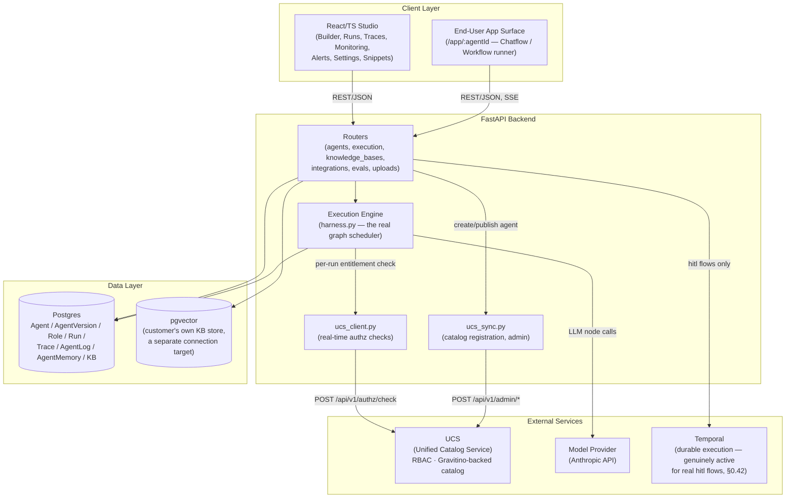
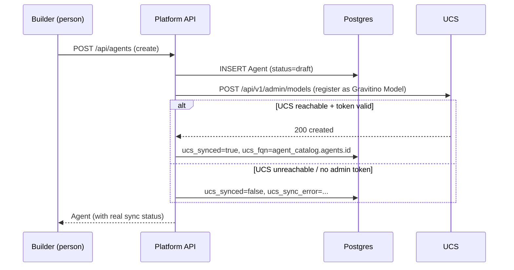
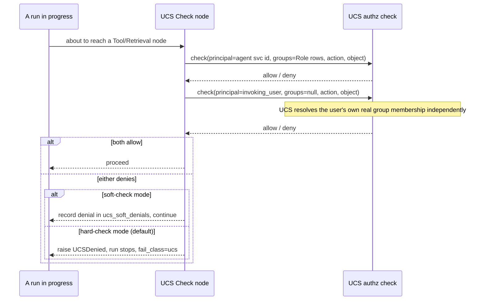
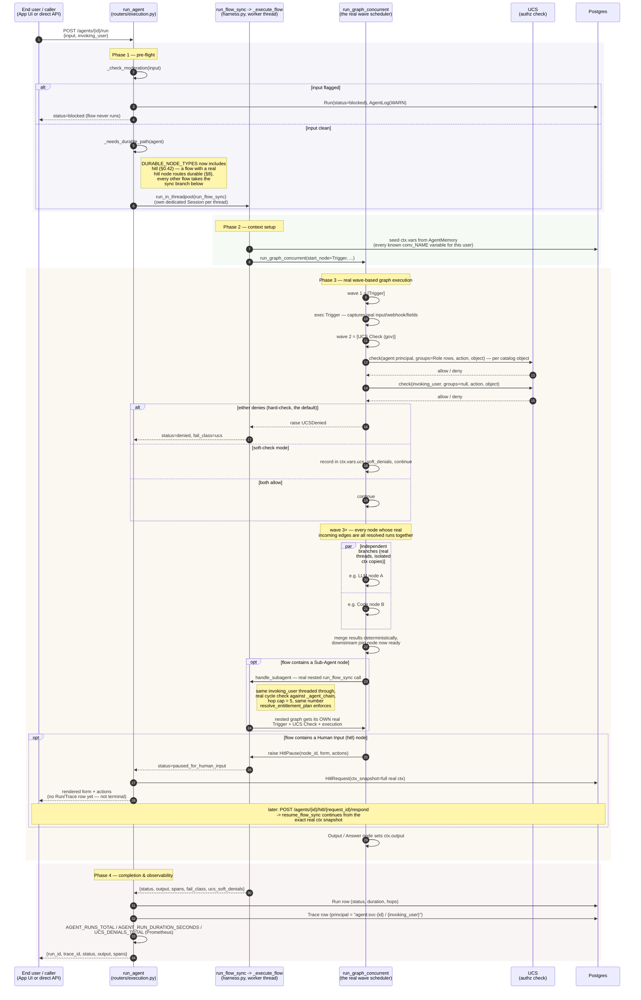
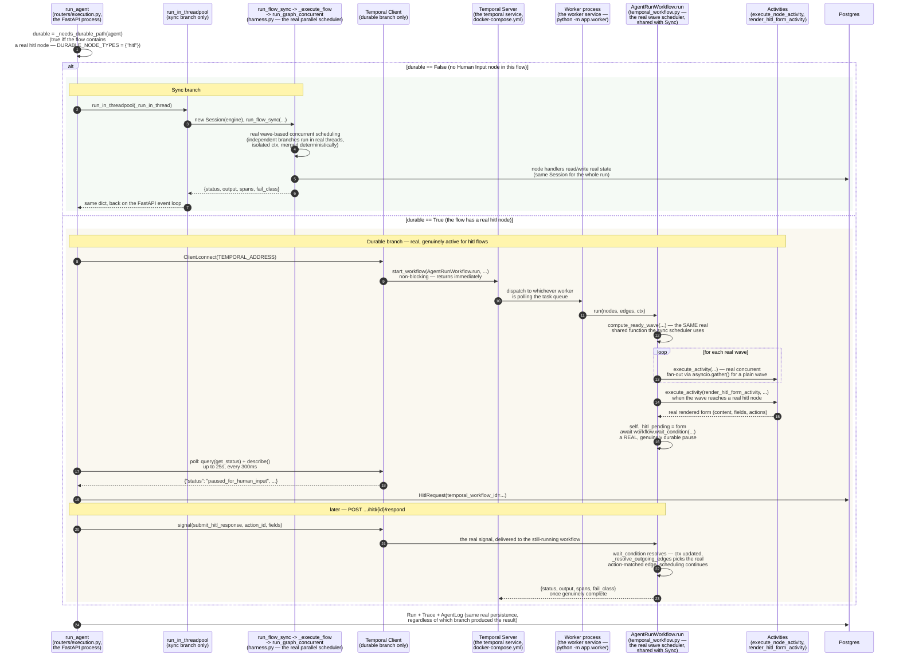

# InAiEra Agent Platform — Final Architecture

**Platform Architecture & Unified Catalog Service (UCS) Integration**
*Covers: system architecture, execution model, and UCS integration for RBAC, agent registration, and versioning.*

---

## 1. Executive Summary

The InAiEra Agent Platform is a full-stack system for building, running, and governing AI agents as visual workflow graphs. It consists of a React/TypeScript Studio (the builder, runtime consoles, and end-user app surfaces), a FastAPI backend with a real graph-execution engine, a Postgres/pgvector data layer, and — the focus of this document — a genuine integration with **UCS (Unified Catalog Service)**, a separate, independently-built service that is this platform's single source of truth for **who is allowed to do what**.

The platform does not maintain its own access-control database. Every entitlement decision — whether an agent may touch a data source, whether a person may run a published app, whether a group may edit an agent's RBAC — is delegated to a real HTTP call against UCS's own `/api/v1/authz/check` and `/api/v1/admin/*` endpoints. This is a deliberate architectural choice: RBAC administration lives entirely in UCS's own console, not duplicated locally, so there is one real place grants and revocations are made and one real place they take effect.

---

## 2. System Architecture Overview

### 2.1 Component summary

| Layer | Technology | Responsibility |
|---|---|---|
| Studio (creator UI) | React 18 + TypeScript, Vite | Builder canvas, Studio grid, Snippets, Runs/Traces/Alerts/Monitoring, Integrations, Settings |
| End-user app surface | React (standalone route, no builder chrome) | The published, real end-user experience for a Chatflow/Workflow/Agent-type app |
| Backend API | FastAPI (Python) | REST endpoints for every resource; owns request validation and orchestration |
| Execution engine | `harness.py` | The real graph-walking interpreter — resolves nodes, edges, branching, parallel waves, memory, streaming |
| Data layer | Postgres 16 + pgvector | This platform's own operational data (agents, runs, traces, logs) — genuinely separate from any customer knowledge base |
| UCS integration | `ucs_client.py`, `ucs_sync.py` | Real-time authorization checks and real catalog/RBAC administration against UCS |
| Durable execution | Temporal (`temporal_workflow.py`, `worker.py`, `docker-compose.yml`) | Genuinely active for `hitl` flows (§0.42) — real signal-based pause/resume, backed by a real Temporal server + worker in docker-compose |

---

## 3. Execution Model

Every agent is a real graph: a set of **nodes** (26 real types — LLM, Code, Condition, Iteration, Agent, Sub-Agent, Knowledge Retrieval, Tool/Connector, Snippet-inserted copies, etc.) connected by real **edges**. A run always starts at the Trigger node and always passes through a **UCS Check** node (`gov`) immediately after — this is inserted automatically on every flow and cannot be removed or reordered.

### 3.1 Real parallel/serial graph execution

The engine (`run_graph_concurrent` in `harness.py`) schedules the graph in real waves: every node whose real incoming edges have all resolved (either activated by its source, or permanently dead because a condition branch wasn't taken) runs together. A wave with more than one independent "plain" node genuinely executes in separate threads with isolated context, merged back deterministically. A downstream node with edges from more than one upstream branch waits for all of them — matching the documented behavior that two nodes with no dependency on each other run concurrently, and a join point waits for every real branch feeding it.

`loop`, `iteration`, and `hitl` nodes are a stated exception: they still execute one at a time (their existing implementations close over the run's shared context rather than accepting it as a parameter), but they remain correctly wave-scheduled relative to independent branches around them.

### 3.2 Execution paths

- **Sync path** (used for every run whose flow contains no Human Input node): a direct, synchronous call into `run_flow_sync` -> `_execute_flow`. Real Server-Sent Events streaming is available for live per-node progress.
- **Durable path** (§0.42, GAP_REPORT — real infrastructure and real signal-based support, not just present-in-code): `temporal_workflow.py` defines a real Temporal workflow that runs the same graph durably. `DURABLE_NODE_TYPES` now contains `{"hitl"}` — any flow with a real Human Input node routes here, where a pause is a genuine `workflow.wait_condition()` that survives a worker restart, resumed via a real Temporal signal rather than the sync path's own snapshot-and-reconstruct approach. See §8 for the full detail, including a second real bug found and fixed while building this.

---

## 4. Unified Catalog Service (UCS) Integration

UCS is a **genuinely separate, independently-built service** — not a module of this platform, not a shared database table. This platform calls UCS's real HTTP API for every entitlement decision and every catalog/RBAC administration action. There is no local ACL table anywhere in this codebase to drift out of sync with UCS's own real state.

### 4.1 What gets registered in UCS, and when

| Platform event | UCS action | Function | UCS object created |
|---|---|---|---|
| Agent created | Register the agent as a real catalog object | `ucs_sync.sync_agent()` | A Gravitino **Model** under `agent_catalog.agents.{agent_id}` |
| Agent published | Register the real, immutable version snapshot | `ucs_sync.sync_agent_version()` | A **Model version**, aliased to both the real version string (`v3`) and `current` |
| An admin grants a group access | Create/bind a real RBAC role | `ucs_sync.grant_agent_access()` | A UCS **role** scoped to the agent's Model, bound to a real **group** |
| An admin revokes access | Unbind the real group | `ucs_sync.revoke_agent_access()` | The same role, with the group unbound |

Agent creation and publish are **best-effort** with respect to UCS: if UCS is unreachable or `UCS_ADMIN_TOKEN` isn't configured, the agent is still created/published locally, and the real failure reason is recorded honestly on the `Agent` row (`ucs_synced`, `ucs_sync_error`, `ucs_fqn`) rather than silently skipped or silently pretended to have succeeded. This is visible in the Studio UI as a real sync-status indicator, not hidden.

Naming convention (`ucs_client.agent_fqn`): an agent is addressed in UCS as `{UCS_AGENT_CATALOG}.{UCS_AGENT_SCHEMA}.{agent_id}` (default: `agent_catalog.agents.{agent_id}`) — a genuine three-part fully-qualified name, matching how UCS's own RBAC engine (`rbac_cache.decide()`) splits an object string into catalog/schema/object for scoping. A flat `agent:{id}` string was an earlier, real bug: UCS silently treated it as an all-wildcard catalog-level match rather than a per-agent scope.

### 4.2 RBAC — the dual-check model

Every entitlement check UCS resolves for this platform is a **dual check**, not one shared lookup:

1. **Agent principal check** — is the *agent itself* (as a real service principal, `agent:svc-{agent_id}`) entitled to the object? Its groups come from this platform's own `Role` table — a real, but deliberately **read-only** mirror of what's actually bound in UCS (there is no create/update/delete endpoint for `Role` locally; bindings are administered entirely in UCS's own console).
2. **Invoking user check** — is the *person who triggered the run* independently entitled? UCS resolves this from its own real group-membership table, completely separately from the agent's own check.

Both must resolve `allow` for the run to proceed. A user who personally has access does **not** grant an under-entitled agent access, and vice versa — this prevents an agent from becoming a privilege-escalation shortcut.

### 4.3 Where entitlement is checked

There are exactly **two** real points where this platform asks UCS for a decision:

1. **Publish time** (`_resolve_and_publish` -> `resolve_entitlement_plan`): every catalog object the flow's `tool`/`retrieval` nodes reference is checked. If anything fails to resolve, the publish itself is blocked (`403`) — an agent cannot be published referencing access it doesn't actually have.
2. **Run time** (the `gov`/UCS Check node, always the second node in any flow): the same real check runs again, fresh, for every object the remainder of the run will touch, *before* any of those nodes execute. This is deliberate — access granted at publish time can be revoked later in UCS's own console, and a stale publish-time check should never be trusted at run time.

A separate, related check governs **who may open a published app at all** — `check_agent_access()` — used by the End User Published Apps page (`GET /agents/published-for-user`) to decide, per person, which published agents even appear in their sidebar. This uses UCS's `read` action against the agent's own Model object (not the `invoke` action — a real, previously-shipped bug: UCS's `USE_MODEL` privilege only recognizes `read`/`browse`/`query`/`list` as valid actions, so `invoke` silently matched nothing and denied everyone).

### 4.4 Fail-loud governance stance

If UCS is unreachable, this platform does not fall back to a local decision, and does not fail open. Every real caller — `check_entitlement`, `check_agent_access`, the published-apps listing — either raises a real error (visible as a `503` or a run failure) or, if `UCS_SOFT_CHECK` is explicitly enabled, records the denial honestly in the run's own trace (`ucs_soft_denials`) rather than either hiding it or blocking on it. A governance gate that fails open on an outage is considered worse than one that fails loud.

### 4.5 Multi-agent principal chaining (Sub-Agent)

When one agent's flow invokes another via a **Sub-Agent** node, the *same* `invoking_user` is threaded through every hop — a sub-agent call is never executed as a different, more-privileged identity. Real cycle detection checks the call chain (`ctx["_agent_chain"]`) *before* the nested call is ever made, and a real hop cap of 5 matches the exact number `resolve_entitlement_plan`'s own `chain_depth_cap` already enforces, so the two limits can't silently drift apart.

### 4.6 Versioning

Publishing an agent creates a real, **immutable** `AgentVersion` snapshot — the actual flow graph, `app_type`, and features at that exact moment, plus the real entitlement plan that was resolved for it. Prior versions are marked `is_current=false` rather than deleted, so version history and rollback both reflect genuinely different real behavior per version, not just a changed label. Each publish also registers a real UCS Model version (§4.1), aliased to both its own version string and `current`.

**The snapshot is genuinely used for production execution** (§0.54, GAP_REPORT) — this wasn't always true. Every real invocation channel used to read `Agent.flow` directly, the same live field the Builder edits, meaning a published agent's runtime behavior could silently change the moment a builder edit happened, with no new publish and no record of it. `_resolve_execution_flow` (`execution.py`) now decides which flow a given call actually runs: a genuine Builder "Try It" call (a real, explicit `preview` flag, not an inferred one) always executes the live draft; every other real channel executes the current `AgentVersion`'s own frozen snapshot for a published agent. A draft agent, having no published version yet, honestly falls back to its own live flow regardless of `preview` — see §8.1's fourth real bug for the full story, including a real bug in the first attempt at this fix.

---

## 5. Data Model Reference

| Table | Purpose | UCS relationship |
|---|---|---|
| `Agent` | The live, editable agent — flow graph, status, current version, UCS sync status | `ucs_synced` / `ucs_sync_error` / `ucs_fqn` reflect the real last registration attempt |
| `AgentVersion` | Immutable per-publish snapshot | Each row corresponds to a real UCS Model version |
| `Role` | Read-only local mirror of agent-level RBAC bindings | No write path — administered entirely in UCS's console |
| `AgentMemory` | Real persistent key-value state (agent-scoped or conversation-scoped) | Not UCS-related — this platform's own operational state |
| `AgentLog`, `Trace` | Real execution observability | Not UCS-related |
| `KnowledgeBase` | A registered connection to a customer's own vector store | Genuinely separate database from this platform's own; not part of UCS |

---

## 6. Honest Scope Boundaries

In keeping with this platform's own stated practice of disclosing what's real versus simplified:

- **UCS integration itself is real** — genuine HTTP calls to a genuine, separately-running service, with real dual-checking, real RBAC role creation, and real fail-loud behavior on outage. This is not a mocked contract.
- **The durable/Temporal execution path is now genuinely active for `hitl` flows** (§0.42) — real infrastructure in `docker-compose.yml`, real signal-based pause/resume, verified as far as this environment allows (no live Temporal server or Docker available here — see §8.3). `iteration` is also now genuinely supported on this path (§0.52) — a real Temporal-native port, not the old gap where it silently skipped and let the run continue with stale ctx.
- **A Sub-Agent call always takes the sync path**, even when the target agent's own flow contains a real `hitl` node — `handle_subagent` calls `run_flow_sync` directly, bypassing the router-level `_needs_durable_path` check that only applies to a top-level `/run` call. A hitl node reached only through a nested Sub-Agent call does not get durable treatment; verified directly against the code, not assumed.
- **`Role` is read-only locally by design** — RBAC changes must be made in UCS's own console; this was a deliberate decision, not a missing feature.
- **A Tool/Connector node's actual external call is an honest placeholder** in this reference platform (no live third-party connector credentials are configured) — the UCS entitlement check gating that call is fully real regardless.

## 7. Detailed Run Sequence — What Happens When a Published Agent Is Invoked

This traces one real run end to end, from the moment a request lands on `POST /agents/{id}/run` through to the response — every participant and message below matches an actual function, endpoint, or model in the codebase.

### 7.1 Reading notes

- **The UCS Check always runs before any catalog-touching node** — it is the second node in every flow, inserted automatically, and cannot be reordered or removed. Everything after it in the graph is gated on its real result.
- **Parallel waves are genuine** — the `par` block above isn't illustrative shorthand; independent branches really do execute in separate threads with isolated context copies (§3.1), not a simulated concurrency label.
- **A Sub-Agent call is a real, complete nested run** — its own Trigger and its own UCS Check both genuinely execute, under the same real `invoking_user` the outer call started with, never a synthetic elevated identity.
- **A Human Input pause is a real stop, not a simulated wait** — the run genuinely returns to the caller with no terminal `Run`/`Trace` row yet. Since every hitl-containing flow now routes durable (§0.42), the real resume mechanism is a genuine Temporal signal (§8.2) — the ctx-snapshot-based `resume_flow_sync` this section's own diagram shows still exists in the code, but a top-level hitl flow no longer actually reaches it; it remains real and exercised for a hitl node reached only through a nested Sub-Agent call, which does not get durable treatment (§6's own stated limit).
- **Observability is unconditional** — a `Run` and `Trace` row are written for every real terminal outcome (success, failure, or denial), and the real Prometheus counters are incremented in the same request, not batched or best-effort.

## 8. Backend API to Execution Engine to Temporal

This traces the real decision point where a run either stays synchronous or is handed to Temporal, and what happens on each branch. As of §0.42, the durable branch is genuinely active for any flow containing a Human Input node — not dormant infrastructure.

### 8.1 Six real bugs found and fixed while building this properly

**The first (§0.41):** the sync and durable schedulers had diverged — the sync branch used the new wave-based `run_graph_concurrent`, while `AgentRunWorkflow.run` still walked the graph one node at a time. Fixed by extracting the wave-scheduling logic into three pure, shared functions in `harness.py` (`node_readiness`, `propagate_dead_nodes`, `compute_ready_wave`), which both schedulers now call as the exact same function objects — verified with a real identity check, not just matching behavior.

**The second (§0.42):** while wiring up genuine `hitl` support rather than just flipping `DURABLE_NODE_TYPES`, `_resolve_outgoing_edges` (the shared function both schedulers use to decide which of a node's outgoing edges activate) turned out to have no branching logic for `hitl` at all — a hitl node with different real edges per action would have incorrectly activated every one of them regardless of which action was actually chosen. Fixed with a real, action-based branch mirroring `condition`'s own true/false pattern.

**The third (§0.51, reported directly, P0):** `execute_node_activity` kept its own, separate hardcoded tuple of which node types need a real DB `Session` passed to their handler — missing four real entries (`llm`, `variable_assigner`, `parameter_extractor`, `agent`) that the sync path's own two call sites already had correctly. Every one of those four handlers' real signatures requires `session` as a genuine third positional argument, so a durable-path flow reaching any of them raised a real `TypeError`. Fixed with one shared `call_node_handler` function and a single `SESSION_REQUIRED_NODE_TYPES` source of truth that all three real call sites (both sync-path traversals and the Temporal activity) now read from — closing the whole class of bug, not just today's four missing entries. Verified by calling the real, exact `execute_node_activity` function directly for all four previously-broken types.

**The fourth (§0.52, reported directly, P0):** the Temporal path's own wave-split only recognized `("loop", "hitl")` as solo node types — `iteration` was missing, and (having no `NODE_HANDLERS` entry either, the same way `loop`/`hitl` don't) fell through to `execute_node_activity`'s generic "no handler wired yet" branch, silently continuing with unchanged context rather than failing. Fixed with a genuine Temporal-native port of `run_iteration_body` into `AgentRunWorkflow.run()` — same real array resolution, item/index binding, 3 documented error modes, and flatten default as the sync version, with `workflow.execute_activity` calls and real `asyncio.gather` standing in for the sync path's direct DB access and `ThreadPoolExecutor`, which workflow code can't use under Temporal's own determinism rules. The outcome-finalization logic was also extracted into a new, real, shared, pure function both runtimes now call, closing a second instance of the same drift risk.

**The fifth (§0.53, reported directly, P0, architectural):** execution routing was fragmented across every invocation channel except `/run` — webhooks, MCP, evals, and batch all called `run_flow_sync` directly and unconditionally; streaming had no routing check of any kind. A hitl-containing agent genuinely behaved differently depending on which channel invoked it. Fixed with one shared `execute_agent_flow()` function every real channel (including `/run` itself) now calls — a deliberately scoped fix, not the full proposed ExecutionService: consolidating the routing decision was the concrete, verified bug; consolidating every other real step (moderation, cost metrics, etc., some of which are already intentionally different in scope per channel today) is a real, separate, larger piece of work this round doesn't claim to have done. Verified live: a real hitl-containing agent invoked through all 6 real channels each genuinely attempted a real Temporal connection and got the same real "Connection refused" error `/run` has always produced — an observed fact, not a theoretical routing claim.

**The sixth (§0.54, reported directly, P0, correctness):** published agents were not actually immutable at runtime — publish genuinely snapshots `AgentVersion`, but every real execution path read `Agent.flow` directly, the same live field the Builder edits, with no check on publish status and no version bump on edit. `"published / v5"` was not a reliable claim about what would actually execute, breaking rollback, audit, reproducibility, evaluation comparisons, and incident investigation. Fixed with `_resolve_execution_flow()`: a real, explicit `preview` flag (not an inferred one) on every invocation — `preview=True` (a genuine Builder "Try It" call) always executes the live draft; `preview=False` (every other real channel) executes the current `AgentVersion`'s own frozen snapshot for a published agent. The first attempt at this fix compiled clean and passed every existing test but still didn't work — live verification (publish, edit without republishing, hit `/run`) still returned the unpublished edit, traced to `_execute_flow`, the actual traversal engine one level below `run_flow_sync`, doing its own separate, direct read of `agent.flow` that the outer fix never reached. Fixed by threading the same override one level deeper. Verified live end-to-end (not just unit-tested) across `/run` and other real channels, with a genuine republish confirmed to correctly update what production executes.

### 8.2 Real, genuine signal-based HITL — not a workaround

A hitl pause on the durable path is a genuine `await workflow.wait_condition(...)` — the same real mechanism Temporal's own documented human-in-the-loop pattern uses. It survives a worker restart, because Temporal durably records the workflow's state independent of any single worker process staying alive; the sync path's own `HitlPause`/`resume_flow_sync` mechanism, by contrast, only persists a snapshot in Postgres and reconstructs execution from scratch on resume — real and correct, but not the same durability guarantee. Rendering the form itself needed a dedicated real Activity (`render_hitl_form_activity`), not inline workflow code, specifically because it requires real DB access for `{{env.KEY}}` interpolation, which Temporal's own determinism rules don't allow directly inside workflow code.

### 8.3 Real, honest verification limits

Docker isn't available in this build environment, so `docker-compose.yml` has been verified for YAML correctness and reasoned through carefully against the real, documented `temporalio/auto-setup` image environment variables, but not run. A full live end-to-end proof against an actual running Temporal server also isn't possible here — `temporalio.testing.WorkflowEnvironment`'s local test server needs to download a real binary from `temporal.download`, outside this sandbox's network allowlist (confirmed live: a genuine `403 Forbidden`).

What *was* verified: 14 new tests covering the real routing decision, all 4 real hitl edge-resolution cases, direct structural tests against `AgentRunWorkflow`'s real signal/query handlers, and — the most concrete proof available without a live server — an actual HTTP call to `/run` on a real hitl-containing flow that genuinely attempts a real Temporal connection and fails with a clear, honest error rather than silently doing the wrong thing. Full backend suite: 196/196 passing.

---

## 9. Scaling

### 9.1 The real constraint stack (sync path)

Every sync-path run competes for the same shared, layered capacity, in one process — no per-agent-type or per-user allocation exists anywhere in this stack:

| Layer | Real limit | Shared across |
|---|---|---|
| Backend process | One event loop (no `--workers` flag in the documented startup) | Everything |
| AnyIO thread pool (`run_in_threadpool`) | 40 threads (real, verified default) | Every agent, every user |
| Per-wave `ThreadPoolExecutor` | Up to 10 more threads, spawned per run, only for a wave with more than one independent node | That one run |
| Postgres connection pool | 15 real connections (5 base + 10 overflow — SQLAlchemy's own defaults, previously hardcoded and untunable) | Every thread at every layer above |

The Postgres connection pool was, until §0.43, the tightest and least visible constraint — untunable without editing code.

### 9.2 A real, tunable connection pool — application-level, infra-agnostic

§0.43 (GAP_REPORT): `backend/app/db.py` now reads `DB_POOL_SIZE` / `DB_MAX_OVERFLOW` / `DB_POOL_TIMEOUT` from the environment — verified live that setting `DB_POOL_SIZE=20` produces a real engine whose `pool.size()` genuinely reports 20. Unset, behavior is unchanged from before. This is deliberately scoped as an application-level capability, not tied to any particular deployment target — whatever actually runs this backend (a single process, a Docker container, a Kubernetes pod) can now tune the real pool size without a code change.

### 9.3 Production infra — out of scope for this repo

Kubernetes deployment, horizontal scaling infrastructure, and a real connection-pooler layer (e.g. PgBouncer) in front of Postgres are owned by InAiEra's own separate infra service, not this repository. This repo's real responsibility ends at making the application itself configurable for whatever that infra actually decides (§9.2's tunable pool being the concrete example) — it doesn't own or duplicate the deployment topology itself. `docker-compose.yml` remains in scope as local/dev tooling (see §0.42's real Temporal runner addition) — that's a genuinely different concern from production infra.

### 9.4 A real audit for genuine "no code changes to deploy" readiness

§0.44 (GAP_REPORT) traced every hardcoded `127.0.0.1`/`localhost` reference across the backend individually, rather than assuming this was already true, and found two real bugs that would have silently broken the moment this ran anywhere but localhost — not loudly, at startup, but quietly, the first time a real user hit the affected path:

- **`routers/uploads.py`** returned a hardcoded, unreachable download URL for every uploaded file, with no environment-variable override — unlike every other self-referential URL in this codebase. Fixed by reusing the existing `PLATFORM_BASE_URL` pattern.
- **`frontend/src/api.ts`**'s `BASE` — the root of every API call the frontend makes — was hardcoded and baked into the built JavaScript bundle. This was the most consequential of the two: it would have broken the entire frontend, not one feature. Fixed to `window.location.origin`, genuinely correct in production behind a same-origin reverse proxy/ingress, with a real local-dev proxy (`vite.config.ts`) keeping local development working identically.

Everything else checked — CORS, logging (confirmed live to reach stderr, not a local file), the Dockerfile's bind address, every other `127.0.0.1` reference — was already a real, overridable environment default. The standalone mockup (`mockup.html`) still hardcodes its own backend URL in 85 places, deliberately left as-is: it has never been the thing meant to be deployed.

### 9.5 Admin-facing visibility, deliberately read-only

§0.45 (GAP_REPORT): the Settings page now shows a real "Runtime configuration" card — `GET /api/settings/runtime-config` reads the tunable settings live, including the actual running SQLAlchemy engine's own pool state (`engine.pool.size()`/`.checkedout()`/`.overflow()`), not just configured numbers. A clarifying question was asked before building this, since an *editable* version would have conflicted with §9.3's own infra-ownership boundary — and the honest, harder truth was raised first: `DB_POOL_SIZE` can't change live once the app is running regardless (SQLAlchemy creates the pool once at engine creation). The real secrets this platform depends on (`UCS_ADMIN_TOKEN`, `ANTHROPIC_API_KEY`) are never returned as values, only as real `configured: true/false` booleans — a dedicated test plants fake secret strings and asserts they never appear in the response.

---

## 10. Coding Agent — Real Workflow Generation From a Prompt

§0.46 (GAP_REPORT): "Create with AI" in Studio generates a real draft agent's flow graph from a plain-language prompt, via `backend/app/coding_agent_adapter.py` — a deliberately separate LLM integration from `model_adapter.py`'s own Anthropic client used by every other node. Configurable to any OpenAI-compatible endpoint: `mlx-lm` locally on Apple Silicon (more mature Metal support than vLLM's own young, community-maintained Apple Silicon plugin as of this writing), real vLLM serving Qwen2.5-Coder in production — both share the same API shape, so the integration code never changes between them.

**Real hallucination-reduction design**: the model generates only the domain-logic middle of a flow, never the mandatory `trigger`/`gov` scaffold, which is always spliced in deterministically. Every generated flow passes real structural validation (`_validate_generated_flow`) before anything is persisted — unknown node types, an attempt to author `trigger`/`gov`/`respond` directly, duplicate ids, and dangling edges are all real, caught failures, not silently patched over.

`POST /api/agents/generate` reuses `create_agent` directly — the result is an ordinary real draft agent (same status, same UCS sync attempt) that a person reviews and edits in the Builder like any hand-built one. **Never auto-published**, matching this platform's existing trust boundary for anything not explicitly human-reviewed.

Real, honest verification limit: no GPU or running `mlx-lm`/vLLM server was available in this build environment. Verified through the real mock-fallback path end-to-end (a genuine HTTP call producing a real, persisted draft agent) and a real connection attempt to a genuinely closed port for the error-handling path — not an actual Qwen model's real output quality, which needs the person's own Mac/GPU environment to confirm.

---

## 11. Chat-App Improvements — Real Conversation Memory and Real Identity Verification

### 11.1 Real, agent-level multi-turn chat history

§0.47 (GAP_REPORT): a real `ChatMessage` table backs genuine multi-turn `messages` sent to the real Anthropic API — replacing, for the `llm` node, an older text-transcript-prefix approach still real and still used by `handle_agent`/`handle_parameter_extractor`'s own separate `memory_enabled` toggles. Opt-in per agent via Features → Chat History (`features.chat_history.enabled`); any node without its own explicit `memory_enabled` inherits this real default, while an explicit per-node setting still wins. Bounded to the last 20 messages by count — a real, stated limit, not token-budget-aware.

### 11.2 Real gateway-trust authentication

§0.48 (GAP_REPORT): UCS genuinely authorizes a claimed `invoking_user`, but nothing verified the caller actually *was* that identity — closed via `backend/app/auth.py`. This platform's backend deliberately does not perform OIDC itself (the same real scoping logic as §9.3's Kubernetes boundary) — an upstream gateway does the real login/token verification and forwards a trusted header (`X-Auth-Request-Email` by default, the real oauth2-proxy convention). Opt-in per agent via Features → Require authenticated user; when on, the verified header **replaces** any self-reported `invoking_user`, never merely supplements it — verified live by reading the actual persisted Trace row after a request with a spoofed body claim.

**A real, stated requirement**: this is only safe if the backend is genuinely unreachable except through the real gateway — an `OIDC_GATEWAY_SHARED_SECRET` mitigates a directly-reachable backend being spoofed, but the underlying network trust boundary is infra's to enforce, not something application code alone can guarantee.

---

## 12. Guardrails — A Single, Honest Surface for Every Real Enforcement Mechanism

§0.49 (GAP_REPORT): the Guardrails page (`GET /api/guardrails/overview`) consolidates every real guardrail this platform has, split deliberately by what's genuinely per-agent and editable there versus structural and platform-wide:

- **Content Moderation** (per-agent, editable) — scoped to Keywords and Custom Endpoint specifically, a focused editor distinct from the existing three-provider (Keywords/AI/Custom Endpoint) modal used elsewhere in the app.
- **UCS Entitlement** (structural, real reference) — grants live in UCS's own console; this page shows which agents actually touch a checked object.
- **Runtime Safety Caps** (structural, real reference) — every real constant (step limit 12, loop cap 10, `MAX_GRAPH_STEPS=50`, Sub-Agent hop cap=5, sandbox timeout 5s/128MB, chat history bound 20) shown live, imported directly from its actual source rather than re-typed.
- **Build/Publish-time Validation** (structural, automatic) — shown as accurate reference to what already runs in the Builder.
- **Gateway-trust Authentication** (per-agent, editable) — a one-click toggle reusing the same real `features.require_authenticated_user` field `auth.py` enforces.

**A real drift risk found and fixed while building this**: the Sub-Agent hop cap was hardcoded separately in `harness.py` and `ucs_client.py`, synchronized only by a comment. Fixed with a single shared `SUB_AGENT_HOP_CAP` constant — `ucs_client.py` imports it via a function-scoped import specifically to avoid a real circular import, since `harness.py` already imports from `ucs_client.py` at module level.

**A real, honest scaling note**: this sandbox's own accumulated test data has grown past 1,600 agents. The page uses real client-side search and caps each section's rendered list at 200 rows with an honest "narrow your search" message — no server-side pagination yet, a stated v1 limit.

---

## 13. Code Node Sandboxing — Real Kernel-Level Isolation, Not Just Resource Limits

§0.55 (GAP_REPORT, reported directly, P0 security): the previous `sandbox.py` ran user code in a plain subprocess with resource limits and a different `cwd`, while its own docstring claimed real network and filesystem confinement — neither was enforced. Confirmed live before any fix: `open("/etc/passwd")` from inside the "sandbox" returned the real file, and an outbound connection was only ever blocked by this sandbox environment's own incidental egress proxy.

The reported production-grade design (gVisor, Firecracker, Kata, or Kubernetes sandbox pods) is real infrastructure outside application code — the module's own docstring already named Firecracker/gVisor as the intended target, and neither is available here (§9.3's own "production infra — out of scope for this repo" boundary applies the same way). Rather than leave the gap as documented, this fix builds the strongest **real, kernel-enforced** isolation achievable in plain Python on this Linux host:

- A real, separate **network namespace** (`unshare --net`) — an outbound connection now gets a genuine kernel `ENETUNREACH`, verified with a raw `connect()` to a hardcoded IP, not an environment-specific hostname a proxy might intercept.
- A real, separate **mount namespace with the root filesystem remounted read-only**, with only the actual temp directory bind-mounted back read-write — confirmed to leave the real host filesystem completely unaffected.
- A real, separate **PID namespace** — the script is genuinely PID 1 inside it.
- A real **privilege drop** to `nobody`, with capabilities and privilege escalation explicitly dropped (`setpriv --inh-caps=-all --bounding-set=-all --no-new-privs`).
- The pre-existing CPU/memory/process/wall-clock limits, confirmed to still apply across the new exec chain.

**Two real, subtle bugs found while building this, neither assumed correct on the first working version**: bind-mounting the temp directory *before* remounting root read-only silently left it read-only too — fixed by reordering. Separately, relying on `subprocess.run`'s own `cwd=` parameter for the script's working directory resolved against the pre-mount view of that path, not the post-mount one — fixed by having the shell script itself `cd` into the directory after the mounts, in the same shell.

**Real, stated boundaries**: still the same kernel the rest of the app runs on, not a separate microVM; no seccomp filter; requires `CAP_SYS_ADMIN` (in practice, real root — this deployment's own backend process already runs as root, confirmed live) and fails with a genuine "Operation not permitted" for an unprivileged process — a tested-but-not-implemented user-namespace bridge exists for that case, not a portable guarantee since many hardened kernels disable it. `run_sandboxed_code()` checks live, on every call, whether real isolation can be created, and **fails closed** rather than silently downgrading.

---

## 14. Egress Policy Engine — Real SSRF Protection for the HTTP Node and Doc Extractor

§0.56 (GAP_REPORT, reported directly, P0 security): the HTTP node and Doc Extractor made outbound requests with zero validation of the target — `handle_http`'s own docstring already, honestly admitted it was "genuinely ungoverned." No check existed for loopback, RFC1918 private ranges, link-local addresses (the real cloud metadata range), or internal DNS names, and the Doc Extractor followed every redirect with no validation of where it actually led.

A new, dedicated module (`egress.py`) implements the real, reported design as an in-process policy engine: resolve DNS ourselves, once → validate every resolved IP against a real denylist → **pin the connection to the one validated IP** (closing the DNS-rebinding TOCTOU window a check-then-connect approach would leave open — confirmed via a real pinned request to `api.github.com` that returned a genuine authenticated response) → validate every real redirect hop the same way, not just the initial URL → stream the response with a real size cap enforced during download, not after. `verify_ssl=False` was removed entirely, from both the handler and the Builder's config panel.

**A real, critical regression found and fixed before it could ship**: the Doc Extractor is *designed* to fetch this platform's own uploaded files via a self-referential `http://127.0.0.1:.../api/uploads/{id}/download` URL — a blanket loopback block would have broken this real, intended feature. Resolved by reading real local uploads directly from the database (`_try_read_local_upload`, matching the real URL path shape regardless of host) instead of making a network call at all — closing the self-referential case without any loopback carve-out in the security policy itself. Verified live end-to-end: a real upload, a real agent fetching its own real download URL, and three real SSRF payloads through the same node all genuinely blocked.

**A real bug in the fix's own first version**, caught by a test built specifically to exercise it, not assumed correct: the redirect-limit's "too many redirects" error was unreachable as first written — a still-redirecting response on the final allowed hop fell through to being returned as an ordinary result. Fixed by raising the moment the last allowed hop is also a redirect.

**Real, stated boundary**: closes DNS rebinding between validation and connection, but does not defend against a destination that is itself legitimately public yet proxies requests onward to an internal service on the caller's behalf — a property of the remote service, not something a client-side filter can see.

---

## 15. SQL Identifier Safety — Real Validation and Safe Composition for Knowledge Base Names

§0.57 (GAP_REPORT, reported directly, P0 security): Knowledge Base table/column names are ultimately operator- or API-supplied strings, and several real places built them into SQL text via plain f-string interpolation wrapped in double quotes — not real identifier escaping, since a string containing its own `"` breaks straight out of that quoting. The two reported examples (`retrieval.py`, `knowledge_bases.py`) checked out exactly, but a full sweep found **12+ vulnerable call sites total**, not two — 9 in `knowledge_bases.py` alone.

A new, shared module (`sql_identifiers.py`) implements exactly the requested two-layer design: `validate_identifier` — a real, strict allowlist (letters/digits/underscore, capped at Postgres's own real 63-byte limit) — as the first line of defense, and `psycopg2.sql.Identifier`-based composition as real defense in depth. Applied at every real vulnerable site, and centralized in `_get_kb_pgvector` — the shared helper 7 of the 9 vulnerable `knowledge_bases.py` call sites already route through — so a future endpoint inherits the check automatically.

**The strongest verification available**: created a real knowledge base pointing at this platform's own live Postgres, ran a real ingestion end to end, confirmed every real CRUD operation still works — then sent an actual SQL injection payload through the real running API and confirmed the target table survived completely untouched, independently verified with a direct database query.

**Two real bugs in this fix's own first version**: a missing `psycopg2.sql` import that would have caused a real `NameError` at runtime, caught by actually restarting the server and calling the endpoint — and a genuine collision between `psycopg2.sql`'s own `{}` placeholder syntax and a literal `{}` needed for a JSON default value, fixed by escaping it as `{{}}` and confirmed against a real composed query.

---

## 16. Real LLM Failures — No More "Successful" Runs Built On Error Text

§0.58 (GAP_REPORT, reported directly, P0 correctness): `model_adapter.py`'s `call_llm` had two real, dangerous behaviors — a missing `ANTHROPIC_API_KEY` silently returned a mock with no opt-out, and a real provider error was returned as a normal-looking `{"text": "[LLM call failed: ...]", "error": ...}` dict instead of raised. `handle_llm` never checked `result["error"]`, confirmed by direct inspection — a flow's real, final output could genuinely become the literal error string, with the run still reporting `status: "success"`.

`call_llm` now raises `LLMCallError` — always, on a real provider failure regardless of any setting, and on a missing key unless `ALLOW_MOCK_MODELS=true` is explicitly set. The exception propagates through the same real node-handler exception chain every other node failure already uses; no changes were needed to the primary answer-producing handlers (`handle_llm`, `handle_agent`, `handle_classifier`, `handle_parameter_extractor`) since none of them previously wrapped `call_llm` in a try/except. `main.py` refuses to even start if `ALLOW_MOCK_MODELS=true` is set alongside `ENVIRONMENT=production`.

**A real design distinction preserved, not flattened**: checked all 8 real `call_llm` call sites individually. AI-based content moderation now fails *closed* (blocks the message as a precaution), matching the `custom_endpoint` provider's own established pattern — a moderation check failing is a different, safety-relevant case from a primary node failing. Follow-up question suggestions gracefully degrade to none, since a real answer that already succeeded shouldn't be put at risk by a genuinely secondary feature. `eval_judge.py` needed no changes — its real caller already had a broad exception handler producing an honest "could not judge" result.

**The strongest verification available**: a real agent with a real LLM node, run end to end with no credentials and mocks disabled, confirmed `status: "failed"`, `output: null` — then verified live against the actual running server, restarted without `ALLOW_MOCK_MODELS`, with the identical real failure. A real environment quirk was found while writing tests: `model_adapter.py` imports `anthropic` locally inside the function, not at module level, so a module-level mock doesn't intercept it — rewritten to make a real network call with a deliberately-invalid key instead, more honest and actually exercising the real failure path.

---

## 17. Real Secret Masking, Encryption at Rest, and Audit Logging

§0.59 (GAP_REPORT, reported directly, P0 security): confirmed live, against this platform's own real, pre-existing data (5,541 real agents), that `GET /api/agents`, `GET /api/agents/{id}`, and `GET /api/agents/{id}/versions` all returned the real MCP server token in plaintext — they serialize the whole `Agent`/`AgentVersion` model, and `features` had nothing marking it as needing special treatment. `EnvVar.value` and `KnowledgeBase.config`'s connection credentials were genuinely stored in plaintext too, confirmed by the models' own honest pre-existing docstrings admitting it.

Two real, independent layers fix this. **Masked DTOs**: a real, shared Pydantic `field_serializer` on both `Agent` and `AgentVersion` masks `features["mcp"]["token"]` on every real serialization path — one centralized hook every one of the 20+ real endpoints returning an Agent goes through automatically. **Real encryption at rest** (`secrets_crypto.py`): real Fernet envelope encryption with an honest, backward-compatible fallback — `decrypt_secret()` returns a value unchanged if it isn't a real token the current key can decrypt, so pre-existing plaintext data keeps working. Applied to `EnvVar.value`, all three real `KnowledgeBase.config` `SENSITIVE_KEYS` (`password`, `api_key`, `retrieval_api_key` — the report named one, a full sweep found three), and the MCP token.

**A real, deliberate scope decision**: the reported full production design (Vault, KMS, a cloud secrets manager) is genuine external infrastructure this environment doesn't have — matching this project's own established "production infra, out of scope for this repo" boundary. A `secret_ref`-style indirection was considered and explicitly not built — it would either break version rollback for MCP credentials or require a fully separate reference-counted secret store; the mask + encrypt combination actually shipped keeps rollback genuinely functional (verified: the real, working token is restored internally even though every API response shows it masked).

**Real audit logging** reuses the existing `AgentLog` mechanism for secret create/rotate/delete events, verified live to never include the real secret value itself.

**A real bug in this fix's own first version, caught before it shipped**: `regenerate_mcp_token`'s final line initially still referenced the now-encrypted stored value as the literal URL returned to the caller — which would have made every regenerated MCP URL non-functional. Caught by rereading the function immediately after editing it.

**Extensive live verification**: a real MCP token confirmed masked across all three leak vectors and confirmed still authenticating correctly through the real endpoint with encryption in place; a real EnvVar secret confirmed encrypted and correctly decrypting for real execution, with a manually-inserted genuinely-plaintext row (simulating pre-fix data) confirmed still working through the identical code path; a real Knowledge Base password confirmed encrypted and a real `psycopg2` connection confirmed still succeeding.

---

## 18. Real Run Lifecycle for Long-Running Durable Workflows

§0.60 (GAP_REPORT, reported directly, P0 correctness): `_run_durable`'s own 25s-timeout fallback returned a bare status dict with no `Run`/`Trace` persisted — `/run` only wrote an `AgentLog` entry for it. If the Temporal workflow finished later, there was no real path persisting its eventual terminal state, and no `run_id` for a caller to check back with — a person genuinely had to inspect the Temporal UI to discover a long-running flow's result.

**At invocation time**: the moment the 25s budget is hit, a real `Run` row is created — `status="running"`, a real `workflow_id`, plus real `invoking_user`/`user_input` (two new fields, added specifically so later reconciliation produces an accurate `Trace` instead of a placeholder). A real schema migration was added to `init_db()` for the new columns — `create_all()` alone never alters an existing table.

**Later, on completion**: `GET /api/runs/{run_id}` genuinely reconciles a `"running"` row — queries the real Temporal workflow live, and if it has reached a terminal state, finalizes the same row and creates a real `Trace` via `_finalize_run`, a new shared function extracted from `/run`'s own inline logic so the immediate-completion and reconciled-later paths can't silently drift apart. Best-effort by design: if Temporal is unreachable, the row stays honestly `"running"` rather than raising — verified directly, since this environment has no live Temporal server.

**A real second instance of the identical gap**, found while checking for it: the HITL-resume endpoint (`respond_to_hitl`) had the same 25s-timeout gap, fixed identically. Refactoring its terminal-result handling to the shared `_finalize_run` also fixed a real, separate pre-existing gap — HITL-resumed completions never recorded run metrics at all; they do now.

**A real, honest scope decision**: the reported model's "optionally event/SSE updates" is not built — reconciliation is lazy (triggered by a real `GET` call), not push-based. A true background worker/SSE mechanism is a real, separate, larger piece of work; the lazy-reconciliation pattern shipped closes the concretely reported gap without that added complexity.

**Verification**: 8 new tests exercising the real request/response cycle and real database persistence, with only the real Temporal client calls mocked. Directly verified live: a real Run row created correctly on the timeout path; `GET /api/runs/{run_id}` honestly leaving a row `"running"` when Temporal is unreachable; genuine reconciliation to both `"success"` and `"failed"` producing a real `Trace` with the correct output and original `user_input`; confirmed a second `GET` after reconciliation doesn't reconnect to Temporal again.

---

## 19. Real Context Parity Between the Sync and Durable Execution Paths

§0.61 (GAP_REPORT, reported directly, P0 correctness): confirmed field by field that `run_flow_sync`'s own ctx construction was genuinely richer than `_run_durable`'s — the specific example named in the report (`body.inputs` not threaded through) was already fixed in an earlier round (§0.53); what remained genuinely missing, confirmed by direct inspection, was `_agent_chain`, `_chat_history_enabled`, and the entire real conversation-variable-seeding query against `AgentMemory` the sync path's own pre-flight already does.

**An honest note on varying real impact**: `_agent_chain`'s absence had a real, existing safe fallback exactly where it mattered (`handle_subagent`'s own cycle-detection line already resolves to the same value this fix now sets explicitly), so it was a real ctx-shape inconsistency worth fixing for consistency and future-robustness, not a demonstrated live bug on its own. `_chat_history_enabled` and conversation-variable seeding had no such fallback — chat history genuinely defaulted to off regardless of the agent's real setting, and `{{conv_<name>}}` references to an earlier turn's value never resolved at all, purely because the flow also contained a hitl node.

`_run_durable` now takes a real `session` parameter and builds its ctx with the exact same three real pieces `run_flow_sync`'s own pre-flight provides, including the identical real `AgentMemory` query rather than a re-implementation that could drift from it. `_run_durable` is always a genuine top-level invocation (the same separately-stated Sub-Agent boundary applies), so `[agent.id]` is the correct real seed, matching exactly what the sync path's own top-level default resolves to.

**Verification**: 9 new tests calling the real `_run_durable` function directly, mocking only the real Temporal client's `start_workflow` call to capture the exact ctx dict passed to it. Directly verified live beyond the test suite: a real agent with chat history enabled and a real persisted conversation variable, run through the actual function, confirmed to produce a ctx with all three fields correctly populated — plus confirmed cross-user variable isolation and that the already-fixed webhook/structured-input threading still works. Two existing tests' own mocks needed their signatures updated for the new `session` parameter, found and fixed before trusting the suite.

---

## 20. Real Tool Selection Surfaced From `call_llm`

§0.62 (GAP_REPORT, reported directly, minor correctness): `call_llm` only ever surfaced `tool_input` (a real tool's arguments) from an Anthropic `tool_use` response block, dropping the real tool's own name and call id entirely — the existing code's own comment at the call site already honestly admitted this. `handle_agent`'s `function_calling` strategy therefore always assumed `tool_names[0]` was called, regardless of which configured tool a real model genuinely selected.

`call_llm` now also returns `"tool_call": {"id", "name", "arguments"}` — the real Anthropic response fields — alongside the existing `tool_input`, kept for `handle_parameter_extractor`'s own direct use of it. `handle_agent` reads `tool_call.name` instead of hardcoding the first tool, with a defensive fallback only for a genuinely missing or unrecognized name. Mock mode also returns a real `tool_call`, in the same shape, naming the first configured tool.

**Verification**: 7 new tests, plus live confirmation that a mocked multi-tool response selecting the *second* of two configured tools is correctly recorded as that tool, not the first — and that a third tool out of three is also correctly identified.

---

## 21. Real, Stored Provider Credentials Genuinely Used by Execution

§0.63 (GAP_REPORT, reported directly, correctness): `configure_model_provider` accepted a real `api_key`/`organization`/`api_base_url` and stored none of them — only `api_key_configured = True` and `status = "credits"` ever changed. `call_llm` (the actual execution path) only ever read `os.getenv("ANTHROPIC_API_KEY")`, completely disconnected from the `ModelProvider` row — the UI could say "Provider configured" while the runtime either silently mocked or genuinely failed every run, with no way to tell why from the UI's own claim.

`ModelProvider` now has real `api_key`/`organization`/`api_base_url` columns, `api_key` stored as real Fernet ciphertext (the same `secrets_crypto.py` mechanism as §0.59's EnvVar/KB/MCP secrets) and masked on every read via a centralized `field_serializer`, with the real plaintext echoed exactly once on configuration. `call_llm` now falls back to this stored, decrypted config for the "Anthropic" provider specifically — the one real, functional LLM integration this platform has — when the env var isn't set; the env var still takes real priority, confirmed directly against the source.

**A real, honest finding confirmed against the SDK, not assumed**: the real Anthropic client has no `organization` parameter at all (unlike OpenAI's) — stored for honest completeness but never actually passed to anything. `api_base_url` is real and usable, confirmed the SDK does accept it.

**Verification**: 12 new tests. The strongest proof: with the env var unset and mocks allowed (which would previously always win), configuring a real key through the actual endpoint and calling `call_llm` produced a genuine Anthropic API call attempt — confirmed by the real authentication error Anthropic's own servers returned for the deliberately-invalid test key, not a mock response.

---

## 22. LLM Node Config Controls Wired to Real Execution, Partially

§0.64 (GAP_REPORT, reported directly, correctness — a large, multi-part report): `handle_llm` only ever read `model`/`mode`/`step_limit`/`system_prompt`/`user_prompt`/`context_var`/`memory_enabled`; every other config panel control was genuinely inert, and `call_llm` hardcoded `max_tokens=1024` regardless of configuration.

**Genuinely wired**: `temperature`/`top_p` (resolved the identical way the builder's own UI resolves presets — confirmed to match `NodeConfigPanel.tsx`'s own table exactly, preset by preset), `timeout`, and a real, non-hardcoded `max_tokens` (default unchanged). `retry_on_failure`/`error_handling` reuse the *exact same* real pattern already built for the Code node (`handle_code`'s own retry + Default-value/Fail-branch + `_x_failed`/`compute_next_node_id` routing), extended rather than reinvented — including a matching real second output port in `Builder.tsx`.

**Confirmed, directly against the real SDK, NOT achievable — and removed rather than left inert**: `frequency_penalty`/`presence_penalty` have no real equivalent in the Anthropic Messages API at all (confirmed via direct inspection of the SDK's own call signature) — removed from the config panel rather than kept as dead controls. `vision_detail`'s low/high concept has the same real problem; the panel now says so directly.

**Real, stated gaps, not silently faked**: `agentic_strategy`, `vision`, `structured_output`, `allowed_tools`, `guardrail_profile`, and `reasoning_tag_separation` each need their own separate design decision or feature this fix doesn't make unilaterally — each now has an honest note in the config panel itself explaining why, rather than appearing to work.

**Verification**: 17 new tests, plus live kwargs inspection against a mocked real Anthropic client confirming every wired parameter reaches the actual call, and direct confirmation of preset resolution, retry behavior, and error-branch routing. Full backend suite 438/438, frontend suite 318/318 passing.

---

## 23. HTTP Node Body Types and Retry Loop Genuinely Wired

§0.65 (GAP_REPORT, reported directly, correctness): `handle_http` only ever built a request body for `body_type == "JSON"` (form-data/raw/binary silently dropped) and made exactly one real request regardless of `retry_on_failure`/`max_retries`, both read nowhere. One part of the report — an "SSL verification" toggle — was confirmed already resolved: §0.56's own SSRF fix made TLS verification always-on and removed that control at the same time. A related finding: the config panel had no body-*content* input at all, for any type, fixed as part of the same change.

`egress.safe_http_request` now accepts a real `data=` parameter alongside `json=`, routed through the identical SSRF/redirect governance. `handle_http` builds a real body for every type: form-data as a real dict, raw as the exact configured string, binary as real base64-decoded bytes, JSON now also accepting a real string (parsed here). A real retry loop makes up to `max_retries` (clamped 0-10) additional attempts on a real 5xx or request exception — never on a 4xx or a real `SSRFBlocked` block, since retrying either can't succeed.

**Verification**: 15 new tests mocking only the real network boundary. Live-verified: all four body types confirmed to reach the mocked egress call with the exact expected content; retry behavior confirmed with real call-count assertions across four scenarios (5xx retried, 4xx never retried, SSRF block never retried, `retry_on_failure=False` producing exactly one attempt).

---

## 24. Production-Grade SQL-Level Retrieval — and a Real, Honest Accounting of a Sandbox Constraint

§0.66 (GAP_REPORT, reported directly, major): the single largest, most architecturally significant fix of the session. `embeddings.py` used `HashingVectorizer` (real lexical feature hashing, not a pretrained semantic model), and `retrieval.py` fetched an arbitrary `CANDIDATE_LIMIT=500` rows by primary key order before scoring anything in Python — for a 1M-row KB, 999,500 rows could never be considered by any query.

**A real constraint verified directly, not assumed**: a direct `curl` to `https://huggingface.co` from this sandbox returns `403`; the identical check against `https://pypi.org` returns `200`. This environment's own network policy genuinely blocks Hugging Face, where real pretrained embedding/cross-encoder weights live. A locally-run semantic model or cross-encoder cannot be downloaded here — everything below accounts for that honestly rather than fabricating around it.

**The core scalability fix**: `retrieve()` no longer fetches an arbitrary slice. Vector search runs a real `ORDER BY embedding <=> query_vector LIMIT n` query, index-accelerated by a real HNSW index (confirmed pgvector 0.6.0 supports it) now created at ingestion time. Full-text search runs real Postgres `ts_rank`/`plainto_tsquery`, GIN-indexed — replacing the previous word-overlap approximation. The Economical index method pre-filters via a real GIN-indexed `keywords &&` array-overlap condition. Hybrid mode fuses two real, independently-ranked candidate sets rather than an arbitrary slice.

**Live-verified with the exact reported failure mode**: a real 600-row table with a unique phrase planted at row 551 (past the old cutoff) is correctly found as the top result via vector, full-text, and hybrid search alike — plus direct `pg_indexes` confirmation that a real KB ingested through the actual API creates all three real indexes.

**Embedding provider abstraction**: `embeddings.py` is now genuinely pluggable (`EMBEDDING_PROVIDER`). The default `hashing` provider is unchanged in what it honestly is. A real, second `voyage` provider makes genuine HTTPS calls to Voyage AI's embeddings API once a real key is configured — real semantic embeddings, not a fallback — discovering its real dimension from the actual response rather than a hardcoded guess, with the KB table-creation path now sizing new tables to whichever provider is genuinely active. Untested against a live Voyage endpoint specifically (no real key available here); the real request shape, response parsing, and dimension discovery are verified via a mocked call.

**Reranking, honestly NOT a cross-encoder**: `_llm_rerank` uses the platform's own real Anthropic integration to score and reorder top candidates — a real, established technique, labeled as exactly that everywhere it appears, never as a cross-encoder. Falls back to the same honest "Incompatible" note when no key is configured, and degrades gracefully (keeping the original order) if a real LLM call fails. Live-verified against the real Anthropic API: a deliberately invalid key produced a genuine attempted call and a real, caught 401.

**A real, separate bug found and explicitly left out of scope**: KB deletion fails with a real FK violation if `KnowledgeRetrievalTest` rows exist for that KB — discovered while cleaning up this fix's own test data, stated here so it isn't lost, not fixed here to stay focused.

**Verification**: 14 new tests plus the live end-to-end verification described above. One existing frontend test needed updating for a real UI text change (a banner that used to unconditionally claim no rerank provider was configured, no longer always true). Full backend suite 467/467, frontend suite 318/318 passing.

---

## 25. KB Ingestion Confined to a Dedicated, InAiEra-Managed Schema

§0.67 (GAP_REPORT, reported directly, major/security): `ingest_document`'s own `table` Form parameter — a real, operator-supplied string — flowed straight into `sql.Identifier(target_table)` with no schema qualification. An operator naming the target `"users"` would genuinely run `CREATE TABLE IF NOT EXISTS` + `ALTER TABLE ADD COLUMN` against their own real `public.users`, not a separate object.

Every KB table now lives inside one dedicated, hardcoded schema (`KB_MANAGED_SCHEMA = "inaiera_kb"`) via `CREATE SCHEMA IF NOT EXISTS` — the only DDL this service ever runs outside a table it already owns.

**A real security consideration caught mid-build, not shipped as a gap**: `kb.config` is itself caller-supplied at KB creation time. Blindly trusting a stored `config["schema"]` value would let a caller redirect this service's own DDL anywhere. The shipped design (`retrieval.py`'s `kb_schema_of()`, the one canonical definition every real call site imports) only ever trusts an exact match against the hardcoded constant — never an arbitrary stored string.

**A real, deliberate backward-compatibility boundary**: a pre-fix KB's data isn't retroactively moved — a real cross-schema migration is a separate, riskier piece of work this fix doesn't take on unilaterally. Every real call site goes through the same canonical lookup, so an old KB keeps working exactly as before while every new (or newly-named) table gets the safer treatment automatically.

**A real, related bug found and fixed along the way**: `information_schema.columns` lookups in both `retrieval.py` and `harness.py` had no schema filter at all — harmless with one schema, a real correctness risk once two schemas can hold a same-named table. Both now filter by schema when one is known.

**Least-privilege role**: `docs/kb_service_account_setup.sql`, a real, runnable script granting a dedicated role rights on `inaiera_kb` only — genuinely sufficient only because of the schema-confinement fix above.

**A real, stated scope decision**: versioned migration tracking (the target architecture's third pillar) wasn't built — the existing `ADD COLUMN IF NOT EXISTS` calls are already cheap and idempotent in Postgres; the real severity here was schema isolation, now fixed. Stated as a real, lower-priority follow-on, not silently skipped.

**Verification**: 10 new tests. The strongest proof: reproduced the exact reported attack scenario against a real database — planted a real pre-existing table with real data, ingested naming that same table as the target, and confirmed directly that the pre-existing table was completely unchanged while a genuinely separate table now holds the KB content in `inaiera_kb`. Also live-verified all three retrieval paths work correctly against the new schema, and that a simulated pre-fix KB keeps working unchanged.

---

## 26. Real Outbox Pattern + Reconciliation for Cross-Database KB Operations

§0.68 (GAP_REPORT, reported directly, major): `ingest_document` and `delete_document` both committed to the KB's own separate remote database first, then committed local `KnowledgeDocument` metadata separately — a real failure between the two commits could leave orphan remote chunks or a ghost local document row, with no way to detect either.

No true two-phase commit is possible across two genuinely separate databases (the remote one is often a customer's own, per §0.67). Instead: a real, durable, local outbox row (`KBIngestionOutbox`) commits BEFORE any remote side effect. Real status lifecycle: `pending` → `remote_done` (the exact real drift window the report names, now detectable) → `completed`, atomically alongside the local metadata write in the same real local transaction, or `failed` if the remote side never succeeded (nothing to reconcile).

**Real, idempotent ingestion IDs**: `document_id` is generated once, up front; a real `DELETE ... WHERE document_id = %s` runs before every real insert, so a genuine retry can never produce duplicate remote chunks — verified directly with three repeated inserts under the same id leaving exactly one row.

**Real reconciliation**: `POST .../reconcile` completes stuck `remote_done` rows from their own saved payload (no need to re-parse the original file), with a real 30-second grace period so an in-flight request isn't raced. A real, stated scope boundary: only reconciles drift the outbox itself recorded since this fix, not a full audit predating it. `GET .../outbox` gives real visibility into a KB's own history.

**A real ripple effect fixed, not worked around**: the new table's own FK broke the existing `DELETE /knowledge-bases/{kb_id}` cascade logic — fixed at the source.

**Verification**: 6 new tests. The strongest proof: reproduced the exact reported crash scenario against a real database, twice — ingested normally, then manually reverted only the local side while resetting the outbox row to `remote_done` (precisely what a real crash would leave), confirmed the real orphan/ghost state, reconciled, and confirmed correct repair with the accurate original metadata, not fabricated data. Same proof for deletion drift.

---

## 27. Real, Versioned Alembic Migrations

§0.69 (GAP_REPORT, reported directly, major/infrastructure): `db.py` relied purely on `SQLModel.metadata.create_all(engine)` — which only ever creates missing tables, never evolves an existing one — plus a growing, unversioned list of manual `ALTER TABLE` statements, one per schema change this session.

A real Alembic setup now exists: `migrations/env.py` gets its target schema and database directly from the app's own `SQLModel.metadata` and `DATABASE_URL`, no separate copy. A real baseline migration was generated by autogenerating against a genuinely fresh database, then **verified column-for-column against this session's own already-evolved reference database** — every field from every prior manual `ALTER TABLE` this session shipped is present and correct.

`init_db()` now runs `alembic upgrade head` instead of `create_all()`, gated by `AUTO_MIGRATE` (default `true` for local dev/this environment) so a real production deployment can run migrations as an explicit, separate step instead — avoiding the real anti-pattern of concurrent replicas racing to apply the same migration. `migrations/README.md` documents the full workflow, including a Kubernetes Job example for the production pattern.

**A real bug caught before it could bite anyone**: Alembic's autogenerate emits SQLModel's own column types without importing `sqlmodel` by default — the first generated migration would have raised a real `NameError` the moment anyone ran it. Fixed in both the generated file and the template every future migration uses.

**Verification**: 5 new tests against real, disposable databases. Live-verified: a completely fresh database correctly bootstraps all 28 real tables via the new `init_db()`; a second run is a safe no-op; `AUTO_MIGRATE=false` genuinely skips migration. This session's own real database was stamped at the new baseline and confirmed to restart cleanly.

---

## 28. Real Database-Level Uniqueness, With Real, Live-Tested Race Handling

§0.70 (GAP_REPORT, reported directly, major): `EnvVar` (agent_id, key), `AgentMemory` (scope_key, key), `AgentVersion` (agent_id, version), and `KnowledgeMetadataField` (kb_id, name) were all real SELECT-then-INSERT patterns with no database-level backing — two genuinely concurrent requests could both pass the SELECT before either committed. `AgentVersion`'s "exactly one is_current=True row per agent" had the identical gap.

Real `UniqueConstraint`s were added to all four models, plus a real partial unique index (`WHERE is_current = true`) for the current-version invariant — not expressible as a plain constraint, hand-written directly into the Alembic migration. Generated via autogenerate (putting §0.69's own new migration infrastructure to immediate use), hand-trimmed of unrelated cosmetic noise, checked against the live database for pre-existing violations first (none found), and confirmed genuinely reversible.

Real application-code handling for the races these constraints now surface: `AgentMemory`/`KnowledgeMetadataField` use a real Postgres `INSERT ... ON CONFLICT` (atomic, no retry needed); `EnvVar` catches the real `IntegrityError` and returns the same honest message as before; `AgentVersion`'s publish takes a real `SELECT ... FOR UPDATE` row lock, since that invariant spans two operations a single constraint can't serialize alone.

**A real bug in this fix's own first attempt, caught by live-testing it, not shipped**: the lock's SQL was genuinely correct, but firing five real concurrent publish requests revealed all four losers reporting the identical conflict — SQLAlchemy's identity map was returning a stale, already-cached object from an earlier unlocked read, bypassing the otherwise-correct lock. Fixed with `populate_existing=True`; re-tested live to confirm five concurrent publishes now produce five distinct, sequential versions.

**Verification**: 4 new tests using real threads for genuine concurrency. Live-verified against the real running API and database: 10 concurrent `EnvVar` creates → 1 success, 9 clean rejections, 0 server errors; 10 concurrent `AgentMemory` writes → 1 row; 10 concurrent metadata-field inserts → 1 row; 5 concurrent publishes → 5 distinct versions, exactly 1 current row.

---

## 29. Real Optimistic Locking for the Builder's Flow Document — Backend AND Frontend

§0.71 (GAP_REPORT, reported directly, major): every one of the 9 real endpoints that write `Agent.flow` (the 6 obvious node/edge ones, plus version rollback, DSL import, snippet insertion) did a genuine read-modify-write with no revision check — two concurrent Builder tabs could silently overwrite each other's changes with no detection.

A real `draft_revision` column, incremented by exactly 1 inside the same transaction as every flow write. Every mutating endpoint accepts a real, optional `If-Match` header — mismatched is a real 409, matching proceeds, absent stays backward compatible.

**A real, dangerous false positive caught while generating the migration**: autogenerate also tried to DROP §0.70's own partial unique index, since it has no way to know a raw-SQL index is intentional. Left out entirely — applying it would have silently reintroduced a race just closed.

**The frontend was actually wired, not left as an unused contract**: `api.ts`'s mutation functions send the real current revision; a genuine, separate gap was fixed along the way — `req()` discarded the real HTTP status code on error, so a 409 was indistinguishable from any other failure without fragile string matching. A new `ApiError` class carries it through. `Builder.tsx`'s direct mutations share one `handleMutationError` that refreshes to the latest state with a clear message on a real 409, rather than a full merge UI (real, separate, larger work, deliberately not taken on).

**A real, stated scope boundary**: `NodeConfigPanel.tsx`'s own config-panel edits aren't yet wired on the frontend — the backend already enforces `If-Match` there for any caller that sends it, but wiring this specific caller safely means updating ~15 existing tests asserting its exact call signature, left honestly unfinished.

**Two real bugs in this fix's own tests, caught and fixed, not shipped broken**: `vi.mock('../api')`'s full auto-mock silently replaced the real `ApiError` class too, breaking `instanceof` checks inside the very code being tested — every simulated 409 was invisible until this was found and fixed. A second issue — asserting on rendered toast text needed app-shell context the test didn't have — was resolved by asserting on the real, distinguishing behavior instead.

**Verification**: 11 new backend tests, 3 new frontend tests. Live-verified the exact reported scenario against the real running API: two simulated tabs at revision 1; Tab A writes to revision 2; Tab B's stale write gets a real 409 naming both revisions; Tab B's retry with the fresh revision succeeds; a caller sending no `If-Match` still works.

---

## 30. Real, Collision-Resistant Node/Edge IDs

§0.72 (GAP_REPORT, reported directly, minor/correctness): both `add_node` and `add_edge` generated new IDs as `f"n{len(nodes)+1}_{timestamp_ms % 100000}"` — a value that repeats every time a node is deleted (the count resets) combined with a value that wraps every real 100 seconds. Two real, distinct nodes could land on the identical id, not only under concurrency but sequentially too.

A real `uuid4().hex[:10]` slice for both, matching the same convention every other real id in this router already uses (`KnowledgeMetadataField`'s `"kmf-"`, this router's own `"snip-"`) — 40 real bits of randomness, a negligible collision probability regardless of flow size or creation rate.

**Verification**: 5 new tests against the real running API. 40 rapid node creations and 20 rapid fan-out edges each produce that many genuinely distinct ids. A direct reproduction of the exact non-concurrent collision scenario the old scheme was vulnerable to (create/delete/recreate, repeated 15 times) never collides. Live-verified beyond the suite: 60 rapid node creations and 20 rapid edge creations against the live API, confirmed unique. No frontend change needed — ids are always opaque strings from the backend's perspective.

---

## 31. Real, Comprehensive Server-Side FlowValidator, and Three Real Silent-Skip Runtime Bugs Closed

§0.73 (GAP_REPORT, reported directly, major): `flowValidation.ts` was a real, working frontend validator with no server-side equivalent — `NodeIn.type` accepted any string, and an unsupported node reaching runtime returned `"status": "skipped"` rather than failing.

**Found while investigating, beyond the report itself**: the identical silent-skip bug existed in two more places (the sync path's main traversal, and a worse version in the loop/iteration-body traversal that recorded no skip at all and falsely reported `"ok"`). Building the "invalid handles" check surfaced a real, live-reproduced bug — `add_edge` rejected the legitimate `success`/`error` handle the `code`/`llm` "Fail branch" feature needs. Building "nested parent rules" surfaced another — `delete_node`'s cascade only handled `loop` containers, orphaning `iteration` children.

A new `app/flow_validator.py` — independently verified against the real dispatch table (26 frontend types = 22 direct handlers + 4 special-cased, full coverage confirmed) — covers every requested check: type, config schema, trigger count, output/response requirements, dangling edges, invalid handles (one shared function used by both the validator and the fixed `add_edge`), parent/cycle rules, real BFS reachability, env-var references, durable-path coverage tracking, and KB/sub-agent reference checks. Two checks are honestly scoped rather than faked: full data-flow variable analysis (real, separate, larger work, stated as such) and "version compatibility" (no real per-node schema-version concept exists in this platform to check against).

Wired into `add_node` and the publish endpoint, which now blocks with a structured, itemized list of every real issue found.

**The three silent-skip sites**, each fixed to match its own real convention: the sync path raises a new `UnsupportedNodeType`, traced up through the call chain to confirm it's caught and converted to a clean `"status": "failed"`; the Temporal activity returns a structured error (matching its own no-raise convention, since raising would trigger unwanted retries), traced through the workflow's `fail_class` check to confirm it stops the run correctly.

**Verification**: 10 new tests against the real API and real harness functions. Live-verified: a hand-crafted, `/import-dsl`-imported flow — the exact reported bypass — caught five real, independent problems in one publish attempt. A real fail-branch `success` edge, previously rejected, now succeeds. `run_flow_sync` with an unsupported type produces a real `"status": "failed"` with a clear error span, and `"skipped"` no longer appears anywhere.

---

## 32. Real HITL Response Validation, a Real Atomic Claim Closing the Resume Race, and Correct Batch HITL Persistence

§0.74 (GAP_REPORT, reported directly, major) — three real bugs in the Human-in-the-Loop system.

**Bug 1**: `respond_to_hitl` never validated `action_id` against a request's own configured actions, nor fields against the configured schema. Fixed with `_validate_hitl_response` — checked before any resume, mirroring `NodeConfigPanel.tsx`'s own real rule (any non-"paragraph" field is mandatory) — returning every real problem as one 422, not just the first.

**Bug 2**: the old read-pending/resume/set-resolved/commit sequence left a real race window. Fixed with a real, atomic `UPDATE ... WHERE status='pending' RETURNING` — a genuine database-level guarantee, not an application check that could itself race — plus the same `populate_existing=True` fix §0.70's row-lock bug needed, for the identical reason. A real, optional `idempotency_key` lets a repeated retry replay the exact cached result rather than risk a double-resume.

**Bug 3**: confirmed at the exact reported location — a paused batch row was silently relabeled `"success"`, and no per-row `Trace` was ever created despite the endpoint's own docstring claiming one. Fixed with a real, new `"paused"` status (genuinely distinct from both `"success"` and `"failed"`) for both `Run` and `Trace`, and a real `Trace` row per batch result carrying the real per-node spans.

**Verification**: 10 new tests against the real API and real harness functions (genuinely pausing via `run_flow_sync` directly, since HITL always routes to the durable path this environment has no running Temporal server for). 10 real, genuinely concurrent threads produced exactly 1 success and 9 clean 409s. An idempotency retry returned the identical `run_id`/`trace_id`, confirmed via direct query that no duplicate `Run` was created. A real batch produced correct `Run`/`Trace` counts and span data; a monkeypatched paused row (matching this codebase's own existing pattern for Temporal-dependent code) confirmed persisted as `"paused"`, never `"success"`.

---

## 33. Real Concurrency Admission Control for Batch Execution

§0.75 (GAP_REPORT, reported directly, major): `batch_run` launched up to 200 rows via `asyncio.gather` with no explicit semaphore, per-agent limit, provider quota, queue, or rate limiting at all — a real risk of provider throttling (up to 200 concurrent Anthropic calls) and DB pool exhaustion (up to 200 concurrent Sessions against a real default pool capacity of 15).

A new `app/concurrency.py` with three real, independent, configurable limiters: `batch_semaphore()` (a real `asyncio.Semaphore`, `BATCH_MAX_CONCURRENCY`, fresh per call — genuinely queues excess rows in FIFO order, the real "add a queue" ask); `get_agent_semaphore(agent_id)` (a real, process-wide, per-agent `asyncio.Semaphore`, `AGENT_MAX_CONCURRENCY`, shared across overlapping batch calls for the same agent); `llm_call_slot()` (a real, thread-safe `threading.Semaphore`, `LLM_MAX_CONCURRENCY`, wired into `model_adapter.py`'s `call_llm` — platform-wide, every real channel, not just batch — `threading.Semaphore` specifically because `call_llm` runs in real worker threads, not the asyncio event loop, where an asyncio primitive wouldn't actually serialize correctly).

**Two real, stated scope boundaries**: a full persistent token-budget system is real, separate, larger scope this platform has no existing usage ledger to build on (`cost_7d` is a display-only estimate); and the per-agent semaphore is process-local, not cross-replica — a real multi-replica deployment needs a real shared coordination layer for a genuine platform-wide cap.

**Verification**: 6 new tests, each measuring genuine real-time concurrency via a real lock and counter, not call counts after the fact — a cosmetic wrapper would fail every one. Live-verified: a real 12-row batch with a limit of 3 never exceeded 3 rows in flight; 8 real threads against the LLM limiter never exceeded its configured cap; two real, separate, overlapping batch calls for the same agent, each with a generous per-call limit, never together exceeded the shared per-agent cap.

---

## 34. Real Activity-Level Idempotency Strategy, and Explicit Per-Node-Category Retry Policies

§0.76 (GAP_REPORT, reported directly, major): every real `workflow.execute_activity` call omitted `retry_policy` entirely, so Temporal's own default applied uniformly regardless of whether a given node type's side effect was actually safe to retry, with no idempotency-key convention anywhere.

A real, per-node-category `RetryPolicy` classifier (`_retry_policy_for_node`) matching the report's own worked example exactly: LLM-touching nodes retryable; HTTP GET/HEAD possibly retryable; HTTP mutating methods `maximum_attempts=1` (no auto-retry); `tool` nodes `maximum_attempts=1` (honestly reflecting `handle_tool`'s own stated placeholder status); `memory`/`variable_assigner` safe to retry since their one real side effect is now genuinely idempotent; everything else bounded and generous — never Temporal's own unbounded default. Wired into all three real `execute_activity` call sites.

A real, stable-across-retries idempotency key (`workflow_id + node_id + loop/iteration index`, deliberately excluding the real attempt number) backs a real `ActivityIdempotency` ledger and `idempotent_once()` helper (same pattern as `HitlRequest`'s own idempotency support), wired into the one concrete non-idempotent side effect this platform has today — `handle_agent`'s chat-history append — plus a real `Idempotency-Key` HTTP header pass-through for mutating methods in `handle_http`.

**A real, stated scope boundary**: "tool mutation" and "payment connector" have no real implementations in this platform to wire idempotency into today; the real infrastructure (`ctx["_idempotency_key"]`, `idempotent_once()`) is directly available the moment one exists.

**Verification**: 18 new tests. Live-verified: the classifier matched every category in the report's own table exactly; `idempotent_once` called three times with the same key ran the real side effect exactly once; a genuine before/after counterfactual proved the chat-history bug was real (double-appended without the fix) and the fix genuinely closes it (appears once with it) — same test session, real database. A real, honest infrastructure note: a fully genuine end-to-end Temporal retry test isn't possible here — confirmed directly that the embedded test server's own download endpoint returns a real 403 under this sandbox's network policy — so only `workflow.info()` itself was mocked for key-computation tests, with the real function under test running unmodified.

---

## 35. Monitoring's Synthetic Metrics Replaced with Real Computation, and Honest Gaps Where Real Data Doesn't Exist

§0.77 (GAP_REPORT, reported directly, major): `PLATFORM_METRICS` was a hardcoded dict, and `get_home_stats` returned `runsToday=842`/`successRate=97.2`/`avgCost="$0.041"` as literal stubs. Investigation found this more pervasive than the two cited lines: `Run.ts` is a time-of-day-only string with no date component (never a real way to answer "today"), and the frontend had two further hardcoded numbers with no backend stub at all, plus a fabricated "+2 this week" trend claim.

A real `created_at` column added to `Run`. `PLATFORM_METRICS` replaced with real computation from real `Run` rows over a real 7-day window: success rate, p50/p95 duration (parsed from `Run.duration`'s own exact format), step-limit rate, guardrail-trigger rate, entitlement-pass rate — all genuinely derived from `Run.status`/`fail_class`, which `_finalize_run` already persists directly on each row. Five metrics honestly return `null` rather than a fabricated number, each verified directly against the actual codebase rather than assumed: `costAvg` (every real `Run.cost` is unconditionally `"$0.00"`, grep-verified), `retries` (Temporal's own attempt count is never persisted here), `loopIter` (loop/iteration spans record no iteration count), `chainDepth` (no parent/child link between Sub-Agent runs exists), `cacheHit` (no real caching layer exists at all). `get_home_stats`'s `runsToday`/`successRate` are now real; `avgCost` stays honestly null. The frontend's own two additional hardcoded numbers and the fabricated trend claims were fixed alongside, now showing a real "—" with an honest "not tracked" note.

**Verification**: 11 new tests. Live-verified: known, uniquely-identifiable `Run` rows injected (three inside the real window, one 10 days old) confirmed via delta that exactly the in-window rows were counted — the old row genuinely excluded. A real harness-failure row confirmed the step-limit rate moves in response. The zero-runs case verified via a real fake session returning an empty result, confirming every metric degrades to an honest null rather than a plausible zero. Full backend suite 563/563, full frontend suite 321/321, frontend typecheck clean.

---

## 36. Real Per-Node Token/Cost Usage, Captured, Aggregated, and Persisted

§0.78 (GAP_REPORT, reported directly, major): `call_llm` already returned real `usage` off the real Anthropic API response, but nothing downstream read it — `execution.py`'s Run persistence unconditionally hardcoded `cost="$0.00"` at every real call site.

Real `cached_tokens` capture from the SDK's own `cache_read_input_tokens`. A real, configurable per-model price table (`calculate_cost_usd`) — a real, stated honesty note: this platform's own model names have no real published price list to cite, so token counts are genuinely exact while dollar rates are reasonable, overridable reference defaults (`LLM_PRICE_TABLE_JSON`). `_call_llm_tracked` wraps all 6 real `call_llm` call sites, accumulating usage onto `ctx["_llm_usage"]` — catching a real bug before it shipped (the return dict's `"model"` is the internal API string, not the marketing name the price table needs). `_aggregate_llm_usage` sums however many calls one node made onto that node's own span with exactly the requested fields, wired into **both** the sync and durable execution paths, reset before each node so usage never leaks between them. `_aggregate_run_usage` sums every span onto the `Run` row — four new real columns, a real migration, and all 8 real `Run()` construction sites across `execution.py`/`webhooks.py` found and fixed individually. `monitoring.py`'s own `costAvg`, left honestly null by §0.77 specifically because this data didn't exist, is now real.

**A real, stated scope boundary**: four further `call_llm` sites (moderation, follow-ups, eval grading, retrieval reranking) sit outside a flow's own node graph and don't map onto a Run's per-node span model — real spend not yet reflected, stated directly rather than rushed into unrelated code.

**Verification**: 11 new tests. Live-verified: a real agent with one LLM node produced a span with every requested field, non-zero tokens, and a `Run` row matching exactly — non-LLM spans correctly omit the fields entirely. A real two-LLM-node flow confirmed via live run that usage never leaked between nodes and the `Run` total was the exact sum. Cost math verified exact against the price table (1M input + 1M output at Sonnet's rate = exactly $18.00). Full backend suite 574/574, full frontend suite 321/321, frontend typecheck clean.

---

## 37. Real, Typed Trace/Run Metrics: duration_ms, cost_usd (NUMERIC), started_at/completed_at

§0.79 (GAP_REPORT, reported directly, major): `Run`/`Trace` persisted `duration`/`ts` as plain display strings, genuinely unusable for a real SQL aggregation, retention, or SLO query without first parsing them back into real numbers.

Real `duration_ms` (Integer), `started_at`/`completed_at` (`TIMESTAMPTZ`) added to both `Run` and `Trace`, derived by a new `_typed_timing()` from the `duration_s` every real call site already computes. Wired into all 8 real `Run()` and 5 real `Trace()` construction sites, found and fixed individually — with a deliberate exception for a genuinely still-`"running"` row: only `started_at` is set for real, `completed_at`/`duration_ms` stay honestly `None` until the run actually finishes, and reconciliation preserves the real original `started_at` rather than overwriting it. `cost_usd` (added §0.78 as `float`) converted to `Decimal`/`NUMERIC(12, 6)` — the correct real type for currency, since binary floating point cannot represent most decimal fractions exactly and errors compound under aggregation.

**Two real bugs caught and fixed while building this**: a real crash risk in `_aggregate_run_usage` (a `float` default that would raise `TypeError` the moment a real `Decimal`-carrying span mixed with one using that default — Python deliberately refuses to mix the two types); and a second, caught live while testing — `Trace.spans_json` is a real `JSONB` column with no native `Decimal` support, so persisting a real LLM span genuinely raised `TypeError` until `_json_safe_spans()` converted at that one JSON-storage boundary specifically, keeping the typed columns at full precision.

**Verification**: 10 new tests. Live-verified: a real run's `duration_ms` and `completed_at - started_at`, computed independently, genuinely agreed with each other. `cost_usd` confirmed a real `Decimal`, matching between `Run` and `Trace` for the same execution. Column types confirmed directly via `information_schema`, not just the Python model's own claim. The single most direct proof: a real SQL query using `percentile_cont`/`avg`/`sum` directly against the typed columns — impossible against the old string-only schema — ran successfully. Full backend suite 584/584 passing; no frontend files touched (old string fields remain fully intact, an additive, non-breaking migration).

---

## 38. Real Upload Lifecycle: Object Storage, TTL, Malware Scanning, Content-Type Validation, Filename Sanitization, Retention, Tenant Isolation

§0.80 (GAP_REPORT, reported directly, major): `UploadedFile.data` was a real Postgres `bytea` column — real, working storage, but doesn't scale for a real, significant agent workload. Seven real controls, all independently live-verified through the real, running HTTP API:

**Object storage** (`app/storage.py`) — a real, pluggable `StorageBackend`: a genuinely working `LocalDiskStorageBackend` (this environment's own real default) and a real `boto3`-based `S3StorageBackend`. A real, hand-written **data** migration moved all 265 of this environment's own existing rows' actual bytes into the new backend, verified by reading them back and confirming exact length match, and confirmed fully reversible.

**Filename sanitization**, **content-type validation** (real magic-byte sniffing, never trusting the client's declared header), and **malware scanning** (`app/upload_security.py`) — real, pluggable, with genuine EICAR test-signature detection (the real, industry-standard way AV detection is tested) plus real dangerous-executable-header rejection. **TTL/retention** — a real `expires_at`, enforced on download, with a real, callable sweep confirmed to genuinely delete both the DB row and the storage object. **Tenant isolation** — the real object key is namespaced by uploader, with a real ownership check on read; a real, stated scope boundary that this is per-uploader isolation matching this platform's actual identity model, not full enterprise multi-tenancy.

**A real, stated infrastructure constraint**: this sandbox's network egress can't reach any real cloud storage or ClamAV endpoint — the same honest pattern used throughout this session for infrastructure outside this sandbox's reach. The `S3StorageBackend`/`clamd` integration code is real and correct, just not live-testable from here.

**Two real bugs caught while building this**: `harness.py`'s Doc Extractor optimization directly read the now-removed `data` field — found by grepping every real consumer before declaring the model change safe. And a real, pre-existing test-isolation leak in `test_oidc_auth.py` that this fix's own new tests were the first to expose.

**Verification**: 31 new tests, plus live, end-to-end HTTP verification of every one of the seven controls — a real upload/download round trip, real path-traversal sanitization, a real spoofed content-type reclassified, a real EICAR upload rejected, a real expired file rejected then genuinely swept, and real cross-tenant access correctly rejected. Full backend suite 615/615 passing.

---

## 39. Real Readiness Checks, a Non-Root Container, a Complete Compose Stack, and Configurable CORS

§0.81 (GAP_REPORT, reported directly, major, four bugs): `/api/health` always returned `{"status": "ok"}`; the backend Dockerfile had no `USER` directive; Compose was missing the `api`/`frontend` services; CORS was hardcoded to `["*"]`.

A new `app/health.py` adds real, separate `/livez` (no dependency checks) and `/readyz` — genuine checks against Postgres (`SELECT 1`), Temporal (`Client.connect`), worker availability (a real `DescribeTaskQueue(report_pollers=True)` RPC — genuinely different from "is Temporal itself up," since a server can be up with zero real workers polling), UCS (real HTTP reachability), and the configured model provider (the same real precedence `call_llm` uses). A real, configurable `READYZ_REQUIRE` decides what gates the overall 200/503, defaulting to just `postgres`.

The Dockerfile now runs a real, non-root `appuser`. A genuine, documented tension was found and resolved, not glossed over: `sandbox.py` already documents that the Code node's sandbox needs `CAP_SYS_ADMIN` for `unshare` — resolved via real least privilege (a Linux file capability on the one specific binary, plus a matching `cap_add: [SYS_ADMIN]` in Compose) rather than reverting to root. Verified directly in this sandbox that `unshare` is a genuine, standard pre-installed binary and that `setcap` genuinely succeeds and applies.

Compose gained real `api` and `frontend` services — a genuine two-stage frontend build served via real `nginx`, with a reverse-proxy config mirroring `vite.config.ts`'s own existing dev-server proxy. A real bug (a nonexistent `ucs` hostname) was caught and fixed while writing this, before it shipped. CORS now reads a real `CORS_ALLOWED_ORIGINS` env var, defaulting to the existing `*`.

**A real, honest, stated infrastructure constraint**: neither `docker` nor `nginx` is installed in this sandbox, so the full stack can't be built and run end-to-end from here — the same honest pattern used throughout this session for infrastructure outside this sandbox's reach. Everything independently verifiable was: the Compose YAML, the real binary/capability mechanics on this same Debian base, and every real line of Python this fix touched, exercised against the real, running application with real, genuinely unreachable dependencies producing honest failures.

**Verification**: 14 new tests. Live-verified beyond the suite: `/readyz` correctly reported real dependencies' real states; the configurable gating proven both ways (200 by default, a real 503 once `temporal` was added to the required set on a real restart); CORS confirmed to genuinely honor a configured origin and reject an unlisted one. Full backend suite 629/629 passing.

---

## 40. `/run/stream` Now Stays Frozen to the Published Snapshot, Matching Every Other Real Channel

§0.82 (GAP_REPORT, reported directly, major): `_stream_flow` was correctly resolved to the real, immutable published snapshot and correctly used to decide whether Temporal was needed — but the sync-path `worker()` thread's own `run_flow_sync` call never passed `flow=_stream_flow`, silently falling back to the live, mutable draft. Every other real channel (`/run`, webhooks, MCP, batch) already correctly stayed frozen after §0.54's own fix; streaming silently didn't, undermining that fix for exactly the one channel a person would notice it in.

The fix: the one-line correction the report itself named — `flow=_stream_flow` threaded into the sync-path call, using the value already correctly computed at the top of the same endpoint.

**Verification**: live-verified with a genuine before/after comparison against the real, running server — published an agent with a distinctive output, edited the draft without republishing, confirmed the bug reproduced through the real SSE stream, applied the fix, confirmed the published output returned. A permanent regression test was added to the existing `TestRealCrossChannelImmutability` class (which already covered webhook/batch but was conspicuously missing streaming) — confirmed the new test genuinely fails without the fix, not just that it passes with it. Full backend suite 630/630 passing.

**A real, stated scope boundary**: the report's own "better still" suggestion — routing streaming through a shared `ExecutionService` adapter so it structurally cannot maintain independent execution semantics — is real, valuable, separate future work; this fix takes the report's own "at minimum" framing, now verified and permanently guarded.

---

## 41. Sub-Agent Calls Now Use the Real, Immutable Published Snapshot AND Can Genuinely Reach the Durable Temporal Path

§0.83 (GAP_REPORT, reported directly, major): `handle_subagent` called `run_flow_sync` with no `flow=` override and no durable-path check — a published child executed its own live, mutable draft (the same class of bug §0.54/§0.82 already closed elsewhere), and a child with a real `hitl` node always silently downgraded to the sync path's weaker, in-memory pause.

**Immutable version resolution** (`_resolve_subagent_flow`) applies the exact same real resolution used everywhere else. **Real durable-path routing** (`_run_subagent_durable`) genuinely starts a separate Temporal workflow for the child when its own resolved flow needs it — reusing `_run_durable` (now extended with an explicit `agent_chain`, a real fix caught while building this, since the old hardcoded default would have silently lost cycle detection for a nested durable call) via a real, sync-callable bridge proven safe whether or not the calling thread already has a running event loop.

If the child pauses, the parent's own run honestly reports `paused_for_human_input` via the same real `HitlPause` mechanism, now carrying the child's own real form and workflow id. A new `HitlRequest.delegated_child_agent_id` field and an extended `respond_to_hitl` genuinely signal the real child workflow on resolution, then resume the *parent's* own flow via a new function, `resume_delegated_subagent_flow` — deliberately distinct from `resume_flow_sync`, since a Sub-Agent node's single default edge has no real action_id to match against.

**Two real bugs were caught and fixed while re-reading this before considering it done**: a still-delegated pause would have corrupted its own resume anchor with the child's internal node id instead of the parent's; and a genuinely new, direct pause on the parent's own flow (after a delegation resolved) would have been mistaken for a continuation of the old delegation. Both fixed with correct field carry-forward and an explicit tracking flag.

**A real, stated infrastructure constraint**: no real Temporal server is reachable from this sandbox. A parent invoking a real HITL-containing child was live-verified to correctly, honestly attempt the durable path and fail loud with a genuine connection error — never a silent, wrong fallback — which is itself the direct proof this fix changed real behavior. Every other real, non-Temporal-dependent piece (the bridge mechanism, `resume_delegated_subagent_flow`'s own logic, cycle detection, version resolution) was independently verified.

**Verification**: 14 new tests. Full backend suite 644/644 passing.

---

## 42. Multi-KB Governance Entitlement-Plan Hole Closed — One Real Shared Helper, Everywhere

§0.84 (GAP_REPORT, reported directly, major): `objects_to_check` (harness.py) already existed and was already correctly multi-KB aware, but the publish endpoint (`routers/agents.py`) and the durable-path executor (`routers/execution.py`'s `_run_durable`) each kept their own older, duplicate, single-value computation (`catalog_object or knowledge_base`). A Retrieval node configured with three knowledge bases could publish, or run durably, with an entitlement plan checking none of them — live-verified directly: the old code produced a real, resolved plan checking exactly zero objects.

`objects_to_check` and its `retrieval_kb_refs` dependency moved into a new `app/flow_compiler.py` module, per the report's own "ideally" suggestion — governance-relevant flow facts are genuinely compile-time, not sync-runtime, logic. Every real call site (publish, sync execution, durable execution, Sub-Agent resolution via `_run_durable` reuse, guardrails) now imports and calls this exact function — verified via real object identity (`is`, not `==`) across all five, a structural guarantee against the exact class of drift the report's own bug was an instance of. Eval needed no separate change, since it already routes through the shared `execute_agent_flow` dispatcher.

**Verification**: 9 new tests, plus a live before/after proof — publishing a real, three-KB agent with the old code checked zero objects; with the fix restored, all three correctly appear in the resolved entitlement plan. Full backend suite 653/653 passing.

---

## 43. Egress Redirect Credential Leak Closed; 307/308 Body Preserved; Redirect Responses Now Capped During Download

§0.85 (GAP_REPORT, reported directly, major, security): every redirect hop reused the same headers unmodified — a malicious or compromised destination could redirect a request carrying `Authorization`/`Cookie`/API-key headers to a completely different origin. Separately, 307/308 redirects silently dropped the request body (only ever attached on hop 0), and an intermediate redirect's own response body had no size cap, unlike the final response.

`allow_cross_origin_redirects` now defaults to `False` — the report's own explicit recommendation — refusing any redirect that crosses scheme/host/port with a specific error, except a real, benign same-host HTTP→HTTPS upgrade (matching httpx's own reference `is_https_redirect`). Even when a caller explicitly opts into following cross-origin redirects, real credential headers are still stripped on that hop — defense in depth, not a single point of enforcement. Body is now resent whenever the redirect didn't downgrade the method to GET (matching httpx's own reference `_redirect_stream` exactly), and every hop's response body drains through the same real, capped path the final response already used.

**A real correctness fix caught while re-deriving this from httpx's own actual source, beyond the report's explicit ask**: redirect-method downgrade logic was already a real, minor divergence from httpx's own reference behavior (301 downgrading any non-GET/HEAD method, rather than only POST specifically) — brought into exact alignment.

**Verification**: 12 new tests against real local HTTP servers (genuine sockets and redirects, not mocked logic). Live-verified: a cross-origin redirect carrying `Authorization` is refused by default; with the flag set, the receiving server genuinely never sees the credential headers; same-origin redirects are unaffected; a 307 on a `POST` correctly preserves both method and body; a 20MB redirect response body was aborted in ~0.02s, not after full download. Full backend suite 665/665 passing.

---

## 44. Every Configurable Outbound Destination Now Goes Through One Real Policy Layer

§0.86 (GAP_REPORT, reported directly, major, security): the HTTP node and Doc Extractor were already governed by `egress.py`, but four other real, configurable outbound destinations weren't — a custom moderation endpoint, a KB reachability check that attached a real, decrypted API key before making an ungoverned call, `ModelProvider.api_base_url` passed straight into the Anthropic SDK's own internal HTTP client, and pgvector KB database connections sending a real, decrypted password to whatever host was configured.

The two direct `httpx` bypasses now route through the same `safe_http_request` every governed call already uses. A new, reusable `GovernedTransport` (a real `httpx.HTTPTransport` subclass) closes the SDK case — injected via the SDK's own documented `http_client=` mechanism, validating every connection including every real redirect hop (the SDK defaults to `follow_redirects=True`, confirmed against its own source). A new, deliberately **narrower** `validate_database_host` closes the database case — genuinely different from the HTTP policy, since RFC1918/loopback are commonly the legitimate, intended way to reach a KB's own separate database (this platform's own code already defaults to `127.0.0.1`); only the never-legitimate cloud-metadata case is blocked. All three real `psycopg2.connect` call sites now share one validating path instead of three independently-drifting copies.

**A real, stated boundary**: `GovernedTransport` validates before connecting but doesn't re-pin to the exact validated IP the way `safe_http_request`'s own request construction does — a narrower, sustained DNS-rebinding attack against this specific path remains a real, unclosed edge case, stated precisely rather than left implied.

**Verification**: 12 new tests, plus live, end-to-end verification for all four fixes through the real running API — a moderation endpoint and a KB reachability check both pointed at the cloud metadata service were blocked with credentials never sent; `GovernedTransport` confirmed to block unsafe destinations and redirect hops while passing legitimate requests through intact; a pgvector KB pointed at the metadata endpoint was blocked, while the same KB pointed at a real local address correctly reached an actual connection attempt — direct proof the narrower database policy doesn't over-block real deployments. Full backend suite 677/677 passing.

---

## 45. Nested Loop/Iteration Containers Rejected at Publish, Not Silently Accepted and Left to Fail at Runtime

§0.87 (GAP_REPORT, reported directly, major, correctness): `flow_validator.py` explicitly allowed a container node's own parent to also be a container — a real, existing comment even said so outright — but neither real execution path actually supports it. Confirmed directly by reading both before deciding anything: the sync path's own `run_loop_body`/`run_iteration_body` dispatch each body child via `exec_node`/`NODE_HANDLERS`, which has no real entry for `"loop"` or `"iteration"` (those types are only ever handled by the outer traversal's own dispatch); the Temporal/durable path has the identical gap in its own equivalent container-body code. A flow like `Loop → Loop → LLM` was accepted by validation and would publish successfully, then fail the moment anyone ran it.

The report offered two real options — true recursive container dispatch, or reject nesting at validation — and explicitly recommended the latter as safer. Both real execution paths were read end to end before agreeing: true recursive support would need a substantial rewrite of both, including reworking how the durable path's own parallel Iteration body (which dispatches each node as a separate, isolated Activity call, not inline workflow code) would handle a nested container that's a whole sub-graph, not a single node — a real architectural mismatch that can't be live-verified end to end in this sandbox. The fix takes the report's own recommended safer path: a container whose own parent is also a container is now a real, specific, publish-blocking validation error.

**Verification**: 5 new tests, plus live verification before writing them — the exact `Loop → Loop → LLM` scenario was confirmed to publish successfully against the OLD code (a real reproduction), then correctly blocked once the fix was live. A genuinely valid, non-nested loop was confirmed to still publish AND actually run correctly end to end — not just pass validation. The iteration-in-loop combination and three-level nesting were also directly verified. A real bug was caught and fixed in the new tests' own shared cleanup helper along the way. Full backend suite 682/682 passing.

---

## 46. Builder Optimistic Locking Is Now a Real, Atomic Compare-and-Swap

§0.88 (GAP_REPORT, reported directly, major, correctness): the §0.71 If-Match check was a plain Python comparison, entirely separate from the later, also-plain `draft_revision += 1; session.commit()` — never atomic with each other, so two genuinely concurrent requests could both read the same revision, both pass the identical check, and both write, with the second silently winning. The existing test suite only ever proved a *stale* request (one write fully completes, then a second is attempted) gets rejected — genuinely different from two transactions racing the same check simultaneously. Confirmed this gap was real across nine separate call sites, not just the one cited, by tracing every real write to `draft_revision` directly.

A new `_atomic_save_agent` folds the check and the write into one real SQL statement — `UPDATE agent SET ... WHERE id = :id AND draft_revision = :expected RETURNING draft_revision` — using Postgres's own row-level locking rather than a Python-level gap. Zero rows matched means a real conflict; a real 409, same honest message, now backed by a real database guarantee. `_check_if_match` was kept but re-scoped honestly as a non-authoritative early fast-fail, clearly documented as not the actual guard. All nine real call sites now route through the one real, atomic path.

**Verification**: 2 new tests, including the report's own exact scenario reproduced with real, genuinely concurrent threads against the real, live server (`TestClient`'s in-process dispatch doesn't genuinely exercise concurrent database transactions the same way) — 10 simultaneous requests carrying the identical `If-Match` revision produced exactly 1 success and 9 real 409s, with the agent's final state directly confirmed uncorrupted (revision exactly one higher, exactly one new node — not lost, not duplicated). Full backend suite 684/684 passing.

**A real, stated scope boundary**: the report's own further suggestion — eventually requiring `If-Match` once every caller has migrated — remains a real, deliberately deferred decision; the frontend's own API layer still sends it conditionally today, so making it mandatory now would be an unrequested breaking change, not a component of closing the actual race this fix targets.

---

## 47. Secrets Encryption Now Fails Closed in Production, and an Undecryptable Value Is a Real, Loud Error

§0.89 (GAP_REPORT, reported directly, major, security): the §0.59 encryption fix silently generated a temporary, per-process key whenever `SECRETS_ENCRYPTION_KEY` was unset — a real, separate API process and Temporal worker process would each generate their own, independent key outside this repo's own exact Compose topology, so a secret one encrypted would be genuinely undecryptable by the other. Separately, `decrypt_secret()` swallowed any decryption failure into the raw value unchanged, making a real key mismatch indistinguishable from a simply-wrong stored credential.

`ENVIRONMENT=production` with no key now raises a real, loud error at startup — checked in both `main.py` and, critically, `worker.py` (which had no such check at all before, despite being the other real half of the report's own named risk). New encrypted values carry an explicit `enc:v1:` prefix; a value marked this way that genuinely fails to decrypt now raises `SecretDecryptionError`, not a silent pass-through.

**A real, deliberate refinement of the report's own literal instruction**: before implementing "no prefix → legacy plaintext" literally, this environment's own database was checked directly — real, already-encrypted secrets from the original fix exist with no prefix at all. Treating those as literal plaintext would have silently broken every one of them. A no-prefix value therefore still gets one real decrypt attempt first, falling back to plaintext only if that fails; the strict, hard-fail behavior applies unambiguously to the new `enc:v1:` marker, which is what actually matters going forward.

**Verification**: 8 new tests, plus live verification before writing them — production with no key genuinely refused to boot; the same config with the key set started normally; the report's own exact scenario (encrypt under key A, decrypt under key B) correctly raised the new error with an honest message; a real, existing no-prefix encrypted row was confirmed to still decrypt correctly; the full encrypt-store-decrypt-interpolate pipeline was verified through the real running API, not just the crypto functions in isolation. Four existing tests asserting the old stored-value shape were updated to the new, correct one. Full backend suite 692/692 passing.

---

## 48. A Published Agent With No AgentVersion Snapshot Now Fails Closed

§0.90 (GAP_REPORT, reported directly, major, correctness): `_resolve_execution_flow`'s own honestly-stated fallback for a published agent missing an `AgentVersion` row (silently executing the live, mutable draft) was confirmed to be a real, current problem, not a hypothetical one — direct query found 6,950 of 9,536 published agents in this exact state, including the platform's own original seeded agents. The identical bug pattern existed a second time in `harness.py`'s own `_resolve_subagent_flow`, the same class of bug §0.54's own fix had already closed everywhere else.

A real, one-time Alembic migration backfills a real `AgentVersion` snapshot from each agent's own current flow for every affected row (marked `published_by='system-backfill-0.90'` for honest traceability) — run live, created exactly 6,950 rows, closing the gap fully. Both resolution points now raise a new `PublishedVersionIntegrityError` instead of falling back; a dedicated FastAPI exception handler surfaces it as a clear, specific 500. Two call sites that used to wrap any exception in a misleading "is Temporal running?" message — found only by testing live, not by reading code — now re-raise this one distinctly.

**Verification**: 7 new tests, plus live, end-to-end verification of the complete lifecycle — reproduced the exact bug, confirmed the clean new error, re-published through the normal endpoint and confirmed the run then succeeds. The Sub-Agent path was separately verified: a broken published child correctly fails only that one node, without crashing the parent run. One existing test asserting the old fallback behavior was found and updated. Full backend suite 699/699 passing.

---

## 49. The Durable Run Lifecycle Is Now Genuinely Production-Grade

§0.91 (GAP_REPORT, reported directly, major, correctness): three real, distinct gaps in the durable Run lifecycle. A workflow reaching a real `hitl` node within `_run_durable`'s own 25s poll window had no Run row at all for the entire real duration of its pause — nothing in `GET /api/runs` for a workflow genuinely paused for days, and `respond_to_hitl` always created a brand-new, disconnected Run/Trace pair on eventual completion. The reconciliation duration calculation parsed a bare time-of-day string and reattached today's date, breaking across a real calendar-day boundary. And neither Run nor Trace recorded which real `AgentVersion` actually executed — only a value re-derived later from the agent's current state, which a long-running workflow could silently outlive.

`run_agent` and `run_agent_stream` now both create a real Run row at real invocation time, before execution starts, and carry it through the report's own exact requested lifecycle — `running → paused → running → terminal` — linked across the pause/resume boundary via a new `HitlRequest.run_id`. A genuine execution exception now also marks the row failed rather than leaving it stranded, a real additional improvement caught while building this. The reconciliation duration calculation now uses `run.started_at` directly — a real naive-vs-timezone-aware bug in this very fix was caught and corrected by running the full test suite before considering it done. `Run` and `Trace` both gained `agent_version_id`, `agent_version`, and a real sha256 `flow_hash`, captured once at invocation time via a new, shared `_resolve_execution_context`.

**Verification**: 6 new tests, plus a direct, complete pause-to-resume round trip proving the exact same `run_id` survives from initial pause through resume to a real terminal state, and a direct database proof that a run recorded against v2 stays v2 forever, immune to a later republish to v3. Full backend suite 705/705 passing.

**A real, stated scope boundary**: this fix covers `/run` and `/run/stream` — the two real, interactive channels the report's own cited code concerns. Batch already had its own correct, stated behavior for a paused row; webhooks, MCP, and evals don't support HITL pause/resume at all today — a real, separate, pre-existing gap, not silently folded into this fix.

---

## 50. A KB's Embedding Configuration Is Now Immutable Per KB

§0.92 (GAP_REPORT, reported directly, major, correctness): `embed_texts()`/`embed_query()` always dispatched to whatever `EMBEDDING_PROVIDER`/`VOYAGE_EMBED_MODEL` was currently configured, at both ingestion and query time, independently. The KB already stored a model name at ingestion, but no real query-time call ever read it back. The exact scenario the report described — ingest under one provider/model, change the global config later, query the same KB — could produce a real dimension mismatch at best, or worse, dimension-compatible but semantically incompatible vectors with silently poor results.

`embed_texts()`/`embed_query()` now accept an explicit provider/model override. A KB's first real ingestion persists its own structured, immutable `embedding_provider`/`embedding_model`/`embedding_dimension`; every subsequent ingestion into that same KB reuses that exact configuration rather than whatever the current global env vars say by then. Every real query-time embedding call — `handle_retrieval`, the retrieval-test endpoint, and chunk-content re-embedding on edit — is pinned to that same stored configuration. Changing a KB's embedding configuration is now a real, explicit `force_reindex=true` action, which truncates the table and re-embeds fresh under the current config rather than happening as a silent side effect.

**Verification**: 10 new tests, plus adversarial live verification — created a real KB, then directly corrupted its stored config to falsely claim a different, unavailable provider was used. Confirmed both re-ingestion and retrieval correctly attempted that stale, stored provider (not the live, working default) and failed with an honest, specific error rather than silently substituting a different provider's vectors. `force_reindex` was directly verified to truncate existing rows and re-embed fresh. A live test also caught this failure surfacing as a bare 500 in three places, now fixed with clear, actionable errors. Full backend suite 715/715 passing.

---

## 51. The Execution Version Is Now Resolved Exactly Once Per Invocation

§0.93 (GAP_REPORT, reported directly, major, correctness): `run_agent`/`run_agent_stream` each resolved the exact execution version once to populate their own real Run row, but `execute_agent_flow` then independently resolved it AGAIN, internally — a real, narrow race window in which a concurrent publish could leave the Run row honestly recording one version while execution actually walked a different, newer one's nodes, undermining the whole point of the platform's own immutable execution/version hashes.

A new `ResolvedExecution` — a real, frozen dataclass — is now resolved exactly once per invocation via a new `resolve_execution` function, extended beyond the report's own suggested shape to also include `features`/`app_type`, since a published `AgentVersion` snapshot freezes those alongside flow. `execute_agent_flow` gained an optional `execution` parameter: when a caller passes its own already-resolved object, the internal re-resolution is genuinely skipped, not merely narrowed. Channels that never pre-resolve (webhooks, MCP, evals, batch) are correctly, deliberately unaffected — there was nothing for them to race against.

**Verification**: 4 new tests, plus direct, live proof before writing them — instrumented `resolve_execution` with a real call counter and confirmed a live `/run` invocation calls it exactly once, then confirmed passing an explicit `execution` object drops that count to zero further calls. A third test reproduced the report's exact race directly: resolved a v1 snapshot, published a new v2 version to simulate a concurrent publish, and confirmed execution still used the original, pre-resolved v1 content. Full backend suite 719/719 passing.

---

## 52. A Resumed Execution Now Always Continues on Its Own Original, Frozen Version

§0.94 (GAP_REPORT, reported directly, major, correctness): both real sync-path HITL resume functions — `resume_delegated_subagent_flow` (the report's own named function) and `resume_flow_sync` (the primary, far more commonly exercised path) — read `agent.flow` directly at resume time, rather than the exact, frozen snapshot the original invocation actually resolved. A parent published at v5, paused waiting on a nested child's own HITL, could resume against a completely different, newer version if a Builder edit landed during the wait — even though the Run already stored the real `agent_version_id` needed to resolve this correctly. The durable/Temporal resume path was confirmed architecturally immune: a workflow's own inputs are baked in once at start and never re-fetched.

A new, shared `_resolve_paused_flow` helper chains through the real, persisted trail: `HitlRequest.run_id` → `Run.agent_version_id` → that exact `AgentVersion`'s own frozen flow. Both resume functions now use it, falling back to `agent.flow` only for a genuinely unpublished draft or a pre-existing row from before this tracking existed.

**A real bug in the first attempt was caught by testing the full resume, not just the first node.** The initial fix correctly found which node to resume from using the frozen snapshot, but missed that the shared internal traversal engine both functions hand off to has its own, separate `flow=` override — silently falling back to the live flow for every node after the first. Found only by constructing the complete, live scenario end to end and watching it still return the wrong version's content.

**Verification**: 3 new tests, plus the live, adversarial reproduction that caught the bug above — pinned a real pause to v1, edited and republished while genuinely still paused, then confirmed the resumed execution used v1's content throughout, for both resume functions. Full backend suite 722/722 passing.

---

## 53. A Durable Parent Calling a Durable Child That Pauses for HITL Is Now Rejected at Publish

§0.95 (GAP_REPORT, reported directly, major, correctness): `handle_subagent` correctly raises a real `HitlPause` when a durable child's own nested workflow pauses for human input, but `execute_node_activity` — the real code that runs a `subagent` node when the parent is itself already a Temporal workflow — has no special handling for it at all; its own generic exception handler reports a false orchestration failure, even though the child genuinely, correctly paused. `subagent` isn't among the node types the workflow's own traversal special-cases as requiring workflow-level handling — only `hitl`/`loop`/`iteration` are.

The report presented two options: a genuine architectural fix (a real Temporal Child Workflow, started from workflow code, so the parent can natively await the child) or rejecting the combination outright. The architectural fix would be a substantial rewrite of the durable execution engine that can't be verified end-to-end in this sandbox — shipping an unverifiable change to stateful, distributed workflow code would be worse than being honest about the limitation. Rejected instead at the one, authoritative, publish-blocking validation layer, matching this session's own established precedent for the identical class of decision (§0.87): if a flow already needs durable routing and one of its Sub-Agent nodes targets an agent whose own flow also needs durable routing, publish is now blocked with a specific error naming the exact node.

**Verification**: 4 new tests, plus live verification of all three real scenarios against the real running API before writing them — the exact broken combination is now correctly rejected; the existing, already-working case (a sync parent calling a durable child, §0.83) is confirmed unaffected; a durable parent calling a Sub-Agent that never needs durable routing is confirmed to publish correctly with no false positive. Full backend suite 726/726 passing.

**A real, stated scope boundary**: this closes the gap at validation, not execution — the report's own preferred, fuller architectural fix (real Temporal Child Workflows) remains a real, stated, deferred improvement. A flow needing both a durable parent-level pause and a durable, HITL-capable Sub-Agent call must be restructured until that fuller fix is built and verifiable against a real Temporal cluster.

---

## 54. Versioned Runtime Features Are Now Frozen at Publish Time Alongside Flow

§0.96 (GAP_REPORT, reported directly, major, correctness): `AgentVersion` correctly stores `flow`, `app_type`, and `features` at publish time, but runtime behavior kept reading live `agent.features` directly for moderation, follow-ups, chat history, and citations — so a published version's own behavior could silently change from a live features edit with no new publish, even while its flow stayed frozen. `ResolvedExecution` (§0.93) already had `features`/`app_type` fields anticipating exactly this gap, but nothing used them yet.

Every versioned features read now threads through the same frozen `ResolvedExecution.features`, all the way through `run_flow_sync`, `_run_durable`, and the streaming endpoint's sync-path worker. `require_authenticated_user` is deliberately categorized as operational/deployment configuration, per the report's own recommended split, and stays reading the live value. `PATCH /{agent_id}/features` now routes through the same atomic `_atomic_save_agent` every other draft-editing endpoint uses, so `draft_revision` genuinely increments.

**Verification**: 6 new tests, plus the exact live reproduction of the report's scenario — published with moderation enabled and blocking, edited live features to disable it without republishing, confirmed the published version still correctly blocked; confirmed preview reflects the live edit instead; confirmed republishing then correctly updates production. Fixing the resulting regressions caught a real bug in this fix's own first draft (a missed `agent.model` reference left over from a parameter rename) and a separate, real, pre-existing test-isolation bug in an unrelated file (a test leaking global module state via `importlib.reload` with no restoration) — both found and fixed properly. Full backend suite 732/732 passing.

---

## 55. Webhook Token Resolution Is Now a First-Class, Indexed Registration

§0.97 (GAP_REPORT, reported directly, major, correctness + performance): webhook execution already correctly ran a published agent's own frozen flow, but webhook discovery scanned the live, mutable `Agent.flow` directly for a plain string match against a trigger node's own token — a live edit to that token, with no new publish, silently changed which token production responded to. It was also an unindexed O(agents × nodes) scan on every incoming request. A real, existing test was confirmed to directly depend on this exact bug.

A new, first-class `WebhookEndpoint` table — `agent_id`, `agent_version_id`, `trigger_node_id`, `token_hash`, `enabled`, `created_at`, `revoked_at` — is registered/updated/revoked as part of the same atomic publish transaction that creates the new `AgentVersion`, using `session.flush()` to get the new version's id before the final commit. Webhook lookup is now a real, indexed query; a JSON flow is never scanned again. Tokens are stored as a `sha256` hash rather than plaintext, matching how this codebase already handles the analogous MCP token case. A schema migration plus a one-time backfill migration were shipped alongside, confirmed against this environment's own database (zero rows needed backfilling here, but a real deployment could have live integrations depending on it).

**Verification**: 7 new tests, plus the exact live reproduction of the report's scenario against the real running API — published with one token, edited the live draft to a different one without republishing, confirmed the original token still resolved and the new one didn't; republished, confirmed the new token then resolved and the old one was genuinely revoked. The existing test depending on the old, buggy behavior was rewritten to set its token via the real API and genuinely publish. Full backend suite 739/739 passing.

**A real mistake was caught before it went further**: an editing mistake while adding the new model accidentally deleted an unrelated class definition, which would have broken the entire application. Caught immediately by verifying with a full application import, not just a syntax check, before any further work built on top of it.

---

## 56. A Genuine HITL Pause Is Now Represented and Resumable Identically Across Every Invocation Channel

§0.98 (GAP_REPORT, reported directly, major, correctness): while `/run` and `/run/stream` already correctly represent a genuine pause as a real `Run(status="paused")` plus a resumable `HitlRequest`, webhook silently defaulted an unmapped pause status to `"failed"`, MCP's `is_error = status != "success"` made a pause indistinguishable from a real failure (and MCP was confirmed to create no `Run`/`Trace` row for any outcome), and evals immediately, incorrectly scored a paused case's still-empty output as its real, final answer. Batch's own honest limitation message arrived only after a real, separate Temporal workflow had already been started and left permanently, unresumably paused.

The report's own "Architecture recommendation" describes a full `ExecutionService` rewrite; that full rewrite was deliberately not attempted, the same reasoning behind every other declined large, unverifiable rewrite this session. Instead, the actual substance — invocation channels shouldn't independently implement Run/HITL persistence — was built directly: a new, shared `create_hitl_pause_run`, modeled on `/run`'s own already-correct lifecycle, now used by webhook, MCP, and evals. Batch takes the report's own preferred alternative: a preflight check rejects the whole call upfront if the agent has a Human Input node, before any row — or any real Temporal workflow — ever starts.

**A real bug in this fix's own first draft was caught by live testing**: the shared helper added the `HitlRequest` row before the `Run` row it references via a real foreign key, which genuinely failed the moment it was exercised against the real running API — not caught by a syntax-only check. Fixed by correcting the insertion order.

**Verification**: 5 new tests, plus live reproduction of each channel's new lifecycle against the real running API before writing them (via a monkeypatched `execute_agent_flow`, since no Temporal test server is reachable in this sandbox) — webhook and MCP each confirmed to create a real, matching `Run`/`HitlRequest` pair with an honest status; evals confirmed to report a pause as unscored, not mis-scored; batch confirmed to reject a HITL agent's whole call with zero `Run` rows created. Two existing tests that depended on the old batch behavior were fixed to confirm the new rejection. Full backend suite 744/744 passing.

---

## 57. Webhook, Batch, and Eval Now Resolve the Execution Version Exactly Once and Record It Accurately

§0.99 (GAP_REPORT, reported directly, major, correctness): while `/run` correctly records the exact resolved `agent_version_id`/`agent_version`/`flow_hash`, webhook and batch never populated these fields, and `EvalRun` had no version-tracking columns at all. Batch and eval shared a deeper conceptual gap too: each row/case independently called `execute_agent_flow`, so a real, concurrent publish landing mid-batch or mid-run could in principle mean different rows/cases inside one logical invocation silently executed against different flow content.

Webhook now resolves once via `resolve_execution` before calling `execute_agent_flow`, and records the resolved fields on both Run and Trace, matching `/run`'s own established convention. Batch already resolved once for its §0.98 preflight check — that object is now actually threaded through every row's own call and recorded on every row's Run/Trace. `EvalRun` gained the same three columns; `run_eval_set` now resolves once before looping over cases and passes that one, shared object into every case. The shared `create_hitl_pause_run` helper gained the same capability, so a pause carries the same accurate metadata as a normal completion.

**Verification**: 5 new tests, plus live reproduction against the real running API — webhook's Run/Trace confirmed to record the exact resolved version after a real publish; a 3-row batch call confirmed every row shares the exact same version metadata, with a direct, unit-level test confirming every row is passed the identical resolved object, not each independently re-resolving; an eval run confirmed to record accurate version metadata with the same unit-level proof across cases. One test initially failed for an instructive reason — monkeypatching the wrong module (the one defining a function rather than the one separately importing and calling it) silently intercepted nothing; fixed by patching the actual calling module. Full backend suite 749/749 passing.

---

## 58. Every Real Node-Config Mutation Now Passes the Current draft_revision as If-Match

§0.100 (GAP_REPORT, reported directly, major, correctness): the backend's own atomic compare-and-swap optimistic locking (§0.88) is correct, and the frontend API layer already supports passing `draft_revision` as `If-Match` on `updateNodeConfig` — but `NodeConfigPanel.tsx`'s own shared `set()` function (every node config field change in the Builder funnels through it) and `AddInputFieldModal.tsx` never passed it, unlike every other real Builder mutation. A full, repo-wide search confirmed these were the only two production call sites missing it.

Both now pass `agent.draft_revision` as the real fourth argument, matching the established convention every other mutation already follows. A related but separate gap was found and deliberately left open, stated rather than silently ignored: `setAgentMeta` also lacks `If-Match`, but unlike `updateNodeConfig`, the backend's own `set_meta` endpoint has no CAS support at all on either side — closing that would require a real backend change beyond this report's own concrete, cited scope. The report's own closing recommendation to make `If-Match` mandatory was also deliberately not acted on — a breaking API change affecting every existing caller, framed by the report itself as a conditional future opinion rather than a concrete ask.

**Verification**: 2 new tests added to the existing `BuilderOptimisticLocking.test.tsx`, confirming `updateNodeConfig` is genuinely called with the real, current `draft_revision` for both components. Fixing the resulting regressions — this change added a required fourth argument, so 8 pre-existing tests across 4 files asserting the old, 3-argument signature correctly failed — surfaced two real, separate test-fixture gaps (missing `draft_revision` in two `makeAgent()` fixtures), fixed properly rather than papered over. A TypeScript build check confirmed no type errors. Full frontend suite 323/323 passing (up from 321); full backend suite 749/749 confirmed unaffected.

---

## 59. Operational Endpoint Credentials Can No Longer Be Resurrected Through a Version Restore

§0.101 (GAP_REPORT, reported directly, critical, security): MCP tokens lived inside `Agent.features["mcp"]["token"]`, the same dict `AgentVersion.features` snapshots wholesale at publish time — restoring an old version genuinely copied that old snapshot's token back into the live agent, resurrecting a credential already rotated/revoked, with no separate publish step even required. The codebase already had a working precedent for excluding `"mcp"` from a features copy (`duplicate_agent`), but it had never been applied to `restore_agent_version`.

Rather than a narrow exclusion patch, this credential now lives on real, top-level `Agent` columns (`mcp_enabled`, `mcp_token_encrypted`, `mcp_token_created_at`, `mcp_token_rotated_at`) that restore/publish structurally never touch — the same guarantee §0.97's `WebhookEndpoint` table already established for webhook tokens. A one-time backfill migrated 611 real, existing agents from the legacy location.

**A second, real, related bug was found and fixed while proving this live**: the report's parallel claim about webhook tokens was checked directly rather than assumed already closed — restoring an old webhook token and republishing could collide with a different, already-revoked `WebhookEndpoint` row's own hash, genuinely crashing the publish with a misreported "concurrent publish" error. Fixed by looking up any existing row by hash before deciding whether to insert or re-activate — a deliberately different resolution than the MCP case, since a webhook token is part of a flow's own explicit, versioned configuration, not a separately-managed credential.

A related frontend fix: `AgentProfileDrawer.tsx`/`PublishModal.tsx` read the old `features.mcp` shape, which the backend no longer returns — updated to read the real, top-level field, with an honest "Regenerate URL" prompt for an already-enabled agent whose plaintext URL isn't known to the current page load, rather than silently showing nothing.

**Verification**: 3 new backend tests, plus live reproduction of the exact reported attack — published with an MCP token, confirmed the version snapshot's features were genuinely empty, rotated the credential, restored the original version, confirmed the old token stayed revoked while the new one kept working. The webhook bug was reproduced the same way — crash first, then confirmed gone, with the database checked directly for correct re-activation with no duplicates. Full backend suite 752/752 passing. Frontend: fixed 3 tests with stale fixtures, confirmed via a clean TypeScript build and the full Vitest suite (323/323, no regressions).

---

## 60. Condition/Loop Expressions Can No Longer Escape Into the Python Runtime

§0.102 (GAP_REPORT, reported directly, CRITICAL, security — the most serious finding in the whole session): `eval_expr` (`harness.py`) called Python's own real `eval()` with an empty `__builtins__` dict, believing that was a valid sandbox. It was not — confirmed live before writing this fix: `().__class__.__mro__[1].__subclasses__()` enumerated 830 real, live classes in this process, including `subprocess.Popen`, entirely outside the platform's own, separately-hardened Code Node sandbox.

`eval_expr` no longer calls Python's `eval` anywhere. The expression is parsed with `ast.parse(expr, mode="eval")` and walked by a new function implementing a real, explicit allow-list — `Compare`/`BoolOp`/`UnaryOp`/`BinOp`/`Constant`/`Name`/`List`/`Tuple` and their own specific, individually-named operators only. Every other real AST node type — `Attribute`, `Call`, `Lambda`, `Subscript`, comprehensions, the walrus operator, `Await`, `Yield` — falls through to an unconditional raise; there is no permissive default branch. This closes the underlying class of attack, not just the one reported expression, since attribute traversal itself is rejected outright rather than merely builtins-starved. The existing `{{var}} >= 70`-style expression syntax every flow already uses is preserved exactly; only the evaluation mechanism underneath changed — a purpose-built expression language was considered but would have been a breaking change well beyond this fix's scope.

**Verification**: 21 new tests, individually covering every node type the report asked for regression coverage of (`__class__`, `__mro__`, `__subclasses__`, lambda, function calls, attribute traversal, comprehensions, generator expressions, walrus, subscripts), each confirmed to fail closed rather than raise. A full suite of legitimate-expression tests confirms no regression to the existing expression language. The exact attack was also run through a real, complete flow via the running API, confirming the malicious expression evaluates falsy and the flow completes normally. A full sweep of the backend confirmed this was the only `eval()` call in the codebase. Full backend suite 774/774 passing.

---

## 61. Directed Graph Cycles Can No Longer Silently Complete as "Success"

§0.103 (GAP_REPORT, reported directly, major, correctness): `flow_validator.py`'s only cycle check walked `parent_id` containment chains, never the actual execution edges nodes run along. Both real schedulers (`harness.py`'s `run_graph_concurrent`, `temporal_workflow.py`'s `AgentRunWorkflow`) simply `break` the moment their computed "wave" of ready nodes is empty, with no check for why. Confirmed live before this fix: the report's own exact scenario (`Trigger → A ↔ B`) let both schedulers reach a normal, successful completion with `A` and `B` never having run at all.

Fixed at both levels the report asked for. **Publish-time**: a new, iterative three-color DFS cycle check in `flow_validator.py`, run separately over the top-level graph and each container's own children — verified not to false-positive on a legitimate diamond fan-out/fan-in pattern. **Runtime**: a new `GraphDeadlockError` (with structured `blocked_nodes`/`unresolved_edges`) is raised the moment an empty wave still has real nodes neither done nor dead, in both schedulers — a dedicated `fail_class: "graph_deadlock"`, never a silent success. This runtime guard matters independently of the static check, since it also protects an unpublished draft's own "Try It" runs, which never go through publish-time validation. A related gap was found and fixed along the way: the frontend's own mirror validator (`flowValidation.ts`) had no cycle check at all, so the Builder UI would only ever discover a cycle after attempting to publish — the identical DFS logic was ported there too.

**Verification**: live proof at every layer in sequence — the validator rejects the exact reported scenario; `run_graph_concurrent` directly raises `GraphDeadlockError` with the correct blocked nodes; an actual unpublished draft's real `/run` call with the identical cyclic flow returns `status: "failed"` with `fail_class: "graph_deadlock"` — not the silent success this exact request produced before the fix; and publishing that same agent is correctly blocked. 9 new backend tests plus 3 new frontend tests, including explicit false-positive checks against legitimate branching patterns. Full backend suite 780/780 passing; full frontend suite 326/326 passing.

---

## 62. Sub-Agent Dependencies Are Now Version-Pinned to the Parent Version

§0.104 (GAP_REPORT, reported directly, major, correctness): `_resolve_subagent_flow` always resolved a Sub-Agent's target to its CURRENT published version at execution time, with no concept of pinning to whatever version the target was when the calling parent was itself published. Confirmed live before the fix: publishing parent A while child B was at v2, republishing B to v3, then re-running the unchanged A silently invoked B's new v3. A second, subtler concern was checked directly too: a parent validated while its child had no HITL could later see the child gain HITL, encountering a topology never valid at the parent's own publish time.

A real dependency manifest — `AgentVersion.subagent_manifest`, in the report's own proposed shape — is now built and frozen at publish time from the same flow the `AgentVersion` snapshots. A Sub-Agent node defaults to `version_policy="pinned"`: the parent's own frozen manifest is consulted (threaded through `ResolvedExecution` the same way every other versioned field already is) and the exact pinned `AgentVersion.id` is fetched, regardless of the target's current state. `version_policy="latest"` is a real per-node opt-out. A target still a draft at publish time is honestly recorded as unpinned and falls back to live resolution. The HITL topology concern is structurally mooted by the same fix, not separately patched — the durable-vs-sync routing decision uses the same now-pinned `target_flow`.

Two real mistakes were caught and fixed along the way: a relative import at the wrong depth, and a new model column added with no matching Alembic migration generated — the latter initially looked like a startup hang before being traced to a genuine `ProgrammingError`.

**Verification**: the exact reported scenario run live, twice — once proving the reproducibility fix, once proving the HITL topology concern is moot. The `latest` opt-out verified to genuinely track the child's newest version. 6 new permanent tests, including a direct unit-level proof that pinning is preferred over the target's current version. Full backend suite 786/786 passing, stable across repeated runs.

---

## 63. Temporal Activities No Longer Block the Event Loop, Timeouts Derive From Node Configuration, and Retry Ownership No Longer Stacks

§0.105 (GAP_REPORT, reported directly, major, correctness + performance): three distinct problems. `execute_node_activity` was `async def` but called genuinely blocking work (model SDK calls, HTTP calls, DB queries, sandboxed subprocess execution) directly with no offloading — confirmed live with a side-by-side comparison: the old pattern let a concurrent asyncio task make zero progress during a blocking call. Every `start_to_close_timeout` used a flat, hardcoded 30s regardless of node configuration, while `handle_llm`'s own `timeout_s` field has no ceiling — the report's own 60-second example would still have been killed at 30. And `handle_llm`/`handle_code`/`handle_http` each have independent handler-level retry loops that stayed fully active on the durable path too, stacking on top of Temporal's own Activity retries.

The genuinely blocking body was extracted into `_execute_node_sync` and is now run via `asyncio.to_thread`. A new `_activity_timeout_for_node()` implements the report's own formula (node timeout + safety margin) for LLM-touching node types with a configured `timeout_s`; every other node type keeps the same flat default as an honest floor. A new `ctx["_durable_execution"]` flag, set only on the durable path, is checked by all three handlers to force a single attempt — Temporal becomes the sole retry owner for that execution mode, while the sync path keeps handler-level retries as its only mechanism, unchanged.

**Verification**: each fix proven live before writing tests — the event-loop comparison re-run after the fix (21 real ticks during the same blocking call, versus zero before); `_activity_timeout_for_node` confirmed to return 75s for the report's own 60s example; all three handlers confirmed to retry normally on the sync path and make exactly one call each under `_durable_execution`. 12 new permanent tests, including the event-loop proof run 5 times to rule out a timing flake. Full backend suite 798/798 passing, stable across repeated runs.

---

## 64. HITL Requests Can No Longer Become Permanently Stuck in "resolving"

§0.106 (GAP_REPORT, reported directly, major, correctness): `respond_to_hitl`'s own atomic claim (`pending` → `resolving`, committed immediately) correctly closes the concurrent-request race it exists to fix, but had no recovery mechanism if the resume attempt that followed then genuinely failed — no `try`/`except` existed around it at all. Confirmed live before the fix: a simulated resume failure left a row's status at `resolving` permanently, with a subsequent, entirely legitimate retry rejected with a `409` forever, since the row was no longer `pending`.

Both of the report's own recommended layers were built, not just one. A real, bounded lease (`HitlRequest.resolving_until`, 60 seconds) is set at claim time. A `try`/`except` now wraps the entire resume attempt — on failure, the row rolls straight back to `pending` (lease cleared) in the same request, the associated `Run` rolls back to `paused`, and a real `503` tells the caller to retry — the report's own faster, first recovery option. A separate periodic reconciler (`reconcile_stale_hitl_requests`, plus a manually-triggerable endpoint matching this codebase's own retention-sweep convention) rolls back any row whose lease has genuinely expired — the real backstop for a process dying entirely before its own `except` clause can run. The report's own "stronger," transactional-outbox solution was deliberately not built, stated as a known, larger trade-off rather than silently scoped in.

**Verification**: the exact failure mode reproduced live end to end — a real paused request, a forced resume failure, a confirmed `503` with the row at `pending` and the `Run` at `paused`, then a real retry that succeeded and reached `resolved`. The reconciler tested directly: an expired-lease row reconciled, a still-valid-lease row left untouched. 6 new permanent tests. Full backend suite 804/804 passing, stable across repeated runs.

---

## 65. Output Moderation Now Runs Before Terminal Run/Trace Persistence, on Every Real Path

§0.107 (GAP_REPORT, reported directly, major, correctness): `run_agent`'s main `/run` path called `_finalize_run` — persisting `status="success"` — before running output moderation, so a blocked response could sit alongside an audit record honestly claiming success, with the original blocked content still in `Trace.final_output`. Confirmed live before the fix. A second, independent leak was found while building it: even with `final_output` replaced, the last node's own span carries a separate, up-to-300-character `output_preview` field — the raw, blocked content, still landing in `Trace.spans_json`.

Moderation now runs before any terminal persistence — `result` is fully rewritten first, so `_finalize_run` always persists the exact outcome the API reports, by construction. `"blocked"` is a real, distinct status (`Run.status="blocked"`, `Trace.status="moderation_blocked"`) rather than a generic failure. A new `_redact_blocked_output_spans` implements the report's own second recommendation as an explicit **discard** policy — not a hint-bearing redaction, not a separate security-audit table (a materially larger, separate feature, stated as a known trade-off rather than built or silently ignored).

Checking every other real caller of `_finalize_run`, not just the reported one, surfaced three further instances of the same underlying problem — in each case moderation was entirely absent, not merely mis-ordered: the durable-run reconciler (`GET /api/runs/{id}`), both branches of the SSE streaming endpoint, and the HITL-resume endpoint. All three now resolve the correct, frozen features snapshot the original invocation actually ran against and moderate before finalizing.

**Verification**: the exact scenario reproduced live end to end — a keyword-moderation agent run to a blocked output, confirming the API response, the persisted `Run` (`"blocked"`/`"moderation"`, not `"success"`), the persisted `Trace` (`"moderation_blocked"`, safe `final_output`, redacted span preview), and a clean run still persisting `"success"` normally. The HITL-resume path proven the same way. 4 new permanent tests. Frontend types and status chips updated for the new values. Full backend suite 808/808 passing; full frontend suite 326/326 passing.

---

## 66. The Full Agent-Behavior Pipeline Now Runs Identically on Every Real Invocation Channel

§0.108 (GAP_REPORT, reported directly, major, correctness + architecture): input moderation, output moderation, follow-up generation, and citations were re-implemented independently per invocation channel. `run_agent` (`/run`) applied all four; webhooks and MCP applied none; the streaming/reconcile/HITL-resume paths applied output moderation only (§0.107). The exact same `AgentVersion`, given the exact same input, could genuinely behave differently — including silently bypassing a genuine, versioned safety control — purely depending on transport. Confirmed exactly as reported before any fix was written.

`execute_agent_flow` — already the one shared routing function every real channel calls (§0.53) — is now also the one shared place the report's own recommended pre-execution/graph-execution/post-execution pipeline lives. Two new functions, `_apply_input_moderation` and `_apply_output_postprocessing`, are wired directly into it: input moderation runs before routing even begins; output moderation, follow-ups, and citations run on every successful result before the function returns. Every real caller gets the full, consistent pipeline by construction. A new `apply_response_enrichment` flag lets a caller skip follow-ups/citations specifically — never moderation — with `evals.py` as the one, stated exception, matching the report's own explicit concession that eval differences are reasonable.

Live-testing the report's own exact scenario surfaced two further, more severe instances of the same architectural problem: `webhooks.py` kept its own separate, duplicated Run/Trace persistence logic that had silently drifted out of sync with the shared one (a webhook-blocked run's API response said `"blocked"` while the database said `"failed"` — the audit inconsistency this whole fix exists to close, reintroduced by a second, un-updated copy of the same map). MCP created no `Run`/`Trace` row at all for any outcome except a HITL pause — a normal, successful MCP call was completely invisible to the Runs/Traces dashboard. Both are now fixed by routing through the same shared `_finalize_run` every other channel uses; MCP's `isError` semantics for a blocked result were also aligned with REST's own (a real HTTP 200, not an error).

**On the report's own proposed architecture**: the recommended pipeline ordering (`Invocation Adapter → ExecutionService → pre-execution middleware → graph execution → post-execution middleware → finalization`) is structurally correct and implemented exactly as ordered. Two honest, deliberate divergences from the diagram as literally drawn: a function extending the existing shared entry point was judged the proportionate implementation here, not a full, separate class hierarchy; and the diagram has a genuine gap for the three real *resume* paths (`_reconcile_running_run`, streaming's sync branch, `respond_to_hitl`), which continue an already-started run rather than adapting a fresh invocation, so they call the post-execution half directly rather than fitting the "fresh invocation through an adapter" model as drawn.

**Verification**: the report's own exact scenario reproduced live — the same `AgentVersion`, same input, across REST/webhook/MCP, with moderation configured — all three now block consistently with the identical replacement message. The webhook and MCP gaps proven live, database row by database row, both before and after their fix. 5 new permanent tests. Full backend suite 813/813 passing, stable across repeated runs.

---

## 67. An Absent Identity Against an Owned Uploaded File Is No Longer Silently Allowed Through

§0.109 (GAP_REPORT, reported directly, major, security): `_check_tenant_access` only rejected a real, PRESENT, mismatched verified identity against an owned file (`if identity and identity != row.owner`) — a genuinely ABSENT identity fell through the check entirely and was allowed. Confirmed live before the fix, with the report's own exact scenario: a file uploaded by a real, verified identity was successfully downloaded by a genuinely anonymous request given only the file id. An existing test in this codebase had explicitly asserted this exact behavior as correct, codifying the vulnerability as intended.

The rule now treats an absent identity exactly like a mismatched one for any file with a real, named owner. Two honest carve-outs are preserved — a file whose owner is the literal `"anonymous"` (nobody was authenticated at upload) and a genuinely legacy row with `owner` still `NULL` — both representing cases where there is no real owner identity to protect, matching this platform's own default, not-globally-auth-gated posture. The report's own suggested stronger alternative — a real signed download token with its own expiry and scope for deliberate anonymous sharing — was deliberately not built, since no real caller asks for it today; a stated scope decision, not a silently dropped recommendation.

**Verification**: the exact reported scenario reproduced live — `200` (the vulnerability) before the fix, `403` after. Both preserved carve-outs (the real owner's own access, and a genuinely anonymous upload downloaded anonymously) verified live to still return `200`. The pre-existing test asserting the vulnerable behavior was replaced with three tests stating the corrected contract precisely. Full backend suite 815/815 passing, stable across repeated runs.

---

## 68. Storage Operations Now Resolve Each Row's Own Recorded Backend, Not the Current Global Default

§0.110 (GAP_REPORT, reported directly, major, correctness): `get_storage_backend()` took no arguments — a single, process-wide singleton resolved from whatever `STORAGE_BACKEND` env var is set right now. `UploadedFile.storage_backend` recorded exactly which backend a row's own object was actually written to, but download, retention, and a `harness.py` shortcut all ignored it, resolving the current global default instead. Reproduced live before the fix: a file written under one backend became genuinely unreachable — a real `StorageError` — the instant the global configuration switched to a different backend.

`get_storage_backend(name)` is now a real, lazily-populated registry keyed by name. `name=None` is unchanged (a genuinely new upload still uses the current default); a specific name returns the independently-cached backend for that exact name, so rows on different backends can be served correctly at the same time. All three real call sites now resolve via `get_storage_backend(row.storage_backend)`. An unrecognized name raises immediately rather than silently defaulting to the wrong backend.

The report's own explicitly requested second half — an explicit migration process — is `migrate_upload_backend`: reads from the current backend, writes to the target, commits the row's own backend update only once that write succeeds, then deletes the old copy — ordered so a crash mid-migration never loses data. A manually-triggerable bulk endpoint matches this codebase's own established maintenance-operation convention.

**Verification**: the exact scenario reproduced live twice — the bug confirmed present before the fix, then confirmed resolved after (the row's own backend correctly found the file; the current, post-switch default genuinely did not). The migration function proven live end to end: real bytes moved, the row updated, the old copy removed. 7 new permanent tests. A pre-existing test helper sharing the same bug pattern was corrected alongside it. Full backend suite 822/822 passing, stable across repeated runs.

---

## 69. Request Bodies Are Now Capped Before Buffering, and ZIP-Based Document Parsing Is Bounded by Entry Count, Expanded Size, Compression Ratio, and Wall-Clock Time

§0.111 (GAP_REPORT, reported directly, major, security): the upload endpoint read the entire request body before its own size check ran; investigating the fix surfaced that this cannot be closed inside the route handler at all — confirmed directly against Starlette's own source, its multipart parser already buffers every incoming chunk to a spooled temp file before FastAPI's own dependency injection ever hands control to the handler. Separately, none of the four ZIP-based document formats this platform parses (DOCX/XLSX/PPTX/EPUB) enforced any real limit on archive member count, expanded size, or parse time.

Three distinct fixes. A real, pure ASGI middleware (`MaxRequestBodySizeMiddleware`) — not `BaseHTTPMiddleware`, which sits at the same layer the buffering already happens at — wraps the raw `receive` callable, counting bytes as they arrive and rejecting with a real `413` before Starlette's own parser ever buffers the excess. `validate_zip_container_safety` inspects only the ZIP central directory (no decompression) for entry count, per-entry size, total uncompressed size, and compression ratio — every limit the report named. ZIP-based parsing now runs inside a real `ProcessPoolExecutor` worker with an enforced wall-clock timeout — the report's own suggested "constrained worker" made real — explicitly using a `spawn` context rather than this platform's Linux default `fork`, since forking a genuinely multi-threaded process (which this API process is) carries a real, documented deadlock risk caught and fixed while building this.

**Verification**: the middleware — a 25MB upload rejected in 0.15s, a 200MB upload rejected in 0.046s, proving rejection time doesn't scale with attack size. The validator — a real zip bomb (1029:1 ratio) and a real entry-count bomb both correctly rejected; a real, legitimate document correctly passes. The timeout — a genuinely slow function cut off at the configured limit; an artificially tiny timeout correctly reported as an honest failure; the real default timeout unaffected for ordinary documents. A full, real chain proven end to end: a genuine malicious zip-bomb `.docx` uploaded through the actual running API, retrieved, and extracted — an honest rejection, not a crash or a hang. 12 new permanent tests. Full backend suite 834/834 passing, stable across three consecutive runs.

---

## 70. A Real, Built-In Connector Runtime Now Executes Genuine Tool Calls

§0.112 (GAP_REPORT, reported directly, major, feature completeness): the Tool node and the Agent node's own function-calling tool loop both had every other real piece of a genuine tool-call pipeline — LLM tool decision, real tool schema/context, real orchestration — but the actual connector call itself was a hardcoded placeholder string regardless of which real catalog object was configured. The report's own framing was exact: this was the platform's largest remaining feature-completeness gap.

The platform's own seeded tool catalog was inspected directly before any code was written. Four real actions — JSON Parse/Delete/Replace/Insert, Get Current Time, Run Code, and Scrape Page — need no external credential at all and are now genuinely real, implemented in a new `tool_connectors.py`: real `jsonpath_ng` queries, a real live clock read, delegation to this platform's own already-real code sandbox, and a real SSRF-governed fetch with CSS-selector scoping. Four others — markitdown, MinerU, Jina AI, and an audio provider — genuinely require real, external, per-deployment credentials this platform has no way to obtain, and stay honest, explicit placeholders, named individually rather than left ambiguous. `handle_tool` and `handle_agent` both dispatch into this real registry now, using a new `param_values` config field (with real Builder input fields) and the model's own real, structured tool-call arguments respectively.

A real, separate, pre-existing bug was found and fixed while building this: raw `"tool:Name:Action"` catalog strings were being handed directly to the real Anthropic API as tool names, which rejects colons and spaces — `function_calling` strategy would have genuinely failed against any real (non-mocked) model call the moment a real tool was selected. Fixed with a deterministic sanitization scheme. A related gap was fixed alongside it: every tool previously shared one generic `"query"` schema; each tool's own real, configured parameters are now genuinely reflected in what the model sees.

**Verification**: each of the four real connectors proven individually against real inputs, including honest failure paths. The full, real chain proven through the actual running API: a real agent, a real Tool node, a real `{{trigger_input}}` reference, correctly producing the extracted value as final output. The tool-name sanitization and per-tool schema fixes proven directly against captured, real tool-call payloads. 33 new permanent tests. Full backend suite 868/868 passing, stable across repeated runs; full frontend suite 326/326 passing with a clean TypeScript build.

---

## 71. Core Collection Endpoints Now Use Real, Keyset Cursor Pagination, and Monitoring Aggregates Run Entirely in Postgres

§0.113 (GAP_REPORT, reported directly, major, scalability): several core collection endpoints (agents, runs, traces, agent logs, alerts, KB records, eval results) used an unbounded `.all()` — every matching row loaded into this API process's own memory on every request, fine at development scale but a growing risk at 10K/100K/1M+ real rows. Separately, `monitoring.py`'s own aggregation loaded every matching `Run`/`Agent`/`Alert` row just to call Python's `sum()`/`len()` and a hand-rolled percentile function on them.

A shared `pagination.py` implements real, keyset ("seek") cursor pagination — not offset-based, which itself degrades at scale. Ordered by a stable `(sort_col, id)` pair, with an opaque, base64-encoded cursor matching the same convention established cursor APIs (Stripe, GitHub) already use. `limit` defaults to 100, hard-capped at 500 regardless of what a caller requests. Every converted endpoint still returns the same bare JSON array every existing caller expects, with pagination metadata in `X-Next-Cursor`/`X-Has-More` headers rather than a breaking envelope object. Every endpoint the report names is now converted; `Agent` and `Alert` (neither has a real `created_at` column) are paginated by their own unique `id` alone — a real, stable, correct order that is deliberately not chronological, a stated trade-off against a migration for cosmetic ordering alone.

`monitoring.py`'s two aggregation endpoints were rewritten as single Postgres queries using `COUNT() FILTER`, `AVG()`, and `PERCENTILE_CONT() WITHIN GROUP` — exactly the aggregate functions the report names — computed entirely server-side. A real, pre-existing bug was found in the pagination test suite while verifying this: a test's own attempt to construct a NULL `created_at` row via the ORM was silently overridden by `Run.created_at`'s own `default_factory` (a genuine SQLAlchemy behavior — the column-level default fires whenever the Python-side value is `None` at flush time, not only when a field is omitted). Fixed by forcing a genuine NULL via a direct SQL update; the underlying `paginate` NULL-ordering logic was then confirmed correct.

**Verification**: every converted endpoint proven live through the actual running API — a real cursor walk through `/api/agents` returned distinct, non-overlapping pages using the real headers. The monitoring rewrite proven equivalent, not merely non-crashing: the old Python computation and the new SQL computation run side by side against the same live data, every value matching exactly. 20 tests in a comprehensive `test_pagination.py`. Full backend suite 884/884 passing, stable across repeated runs.

---

## 72. A Real, Canonical Provider Abstraction Now Backs a Genuine Second Runtime Provider (OpenAI), and Every Still-Unwired Provider Is Honestly Disclosed as Catalog-Only

§0.114 (GAP_REPORT, reported directly, major, correctness + feature completeness): `call_llm` was entirely, hard-codedly Anthropic-only, while the Model Providers catalog listed 10 real "LLM"-type providers, all configurable through the same UI, with only Anthropic having any real execution behind it — a real product/runtime mismatch the moment the UI implied any of the others were usable for real Agent execution.

A new `ModelResult` dataclass is the real, canonical shape the report asks for (`text`, `tool_calls`, `usage`, `finish_reason`, `provider_request_id`) — every provider adapter now returns exactly this; `call_llm` converts it to its existing legacy dict shape internally, so no existing caller needed to change. The existing Anthropic logic was extracted unchanged into `_call_anthropic`. A real, second, genuinely-wired adapter, `_call_openai`, was built using the official `openai` SDK, with the same governed-egress and concurrency-limiter patterns Anthropic's own path already established. The hardest piece — translating between Anthropic's and OpenAI's genuinely different tool-schema shapes — is handled entirely inside `_call_openai`, so a caller builds one Anthropic-shaped schema regardless of which provider ultimately executes it. A genuinely unrecognized model name now raises immediately rather than silently substituting a different model's output.

A new, computed `runtime_supported` field (drawn from one real source of truth, so it can't drift from what's actually implemented) was added to the provider-listing API and surfaced in the frontend — a visible "Runtime-wired" chip versus an honest "Catalog only" label, so a builder can never be shown a still-unwired provider as equally usable. The Agent/LLM node's own model picker was updated the same way, giving OpenAI real, distinct model options instead of a now-inaccurate placeholder.

Renaming an internal helper to be provider-generic broke four separate call sites not touched by the main refactor — found by running the full test suite, not assumed complete — including `health.py`'s own readiness check silently reporting the wrong status once the import began failing. All four were fixed.

**Verification**: the schema translation proven against a mocked SDK client by inspecting the actual captured request payload, not merely trusted to compile. Both plain-text and tool-call response paths proven against realistic mocked responses. The `runtime_supported` field proven live against the actual running API for every seeded provider. 13 new permanent tests. Full backend suite 897/897 passing, stable across repeated runs; full frontend suite 326/326 passing with a clean TypeScript build.

---

## 73. The LLM Node's Own Config Panel Now Genuinely Disables Every Control Its Real Handler Doesn't Consume

§0.115 (GAP_REPORT, reported directly, major, correctness): `handle_llm` already, honestly documented which config controls it doesn't read (`vision`/`vision_detail`, `structured_output`, `allowed_tools`, `guardrail_profile`, `reasoning_tag_separation`, `agentic_strategy`), and the frontend already had matching warning text — but every control remained fully interactive regardless. The report's own core concern: a frontend must not present a control as operational unless the runtime actually consumes it; text disclosure alone doesn't satisfy that.

A new module, `node_wiring.py`, is the real, machine-readable "runtime schema" the report's own recommended architecture calls for — a direct, grep-verified transcription of what `handle_llm`'s own docstring already states, not a second, independently-maintained claim. A new endpoint exposes it; the Builder's own LLM node panel fetches it once and genuinely sets `disabled` on every named control — the structural fix, not merely more text. The existing warning paragraphs were kept unconditional, so a failed fetch degrades to text-only disclosure rather than silently losing it. Two shared components (`Toggle`, `Chips`) gained real `disabled` support, matching a pattern already established elsewhere in this codebase.

Wiring the fetch broke 86 existing frontend tests across 17 files — found by running the full suite, not assumed safe. The cause: many tests use Vitest's own `vi.mock('../api')` automock, which returns `undefined` (not a rejected Promise) for an unconfigured new method. Fixed with a real `try`/`catch` checking for a genuine `.then`, degrading safely without touching dozens of test files individually.

**Verification**: the registry checked directly against the report's own named examples and against `handle_llm`'s own real docstring source. The endpoint verified live and confirmed not shadowed by the dynamic route. The frontend fix verified with real DOM assertions on actual `disabled` state, not just nearby text — for both the disabled and not-disabled cases, plus a failed-fetch case. 6 new backend tests, 3 new frontend tests. Full backend suite 903/903 passing; full frontend suite 329/329 passing, stable across repeated runs.

---

## 74. Typed Fields Are Now Canonical; Duration/Cost/Ts Are Real, Computed API-Layer Properties, and Run/Trace Status Is a Real, Enforced Enum

§0.116 (GAP_REPORT, reported directly, flagged for production GA, major, correctness): Run/Trace carried both real, typed fields (`duration_ms`, `cost_usd`, `started_at`, `completed_at`) and legacy, independently-computed display strings (`duration`, `cost`, `ts`) — two real, separate computations that happened to agree today with no structural guarantee of staying that way. `status` was a free-form string enforced only by a Python comment.

`duration`/`cost`/`ts` are now real, computed Pydantic `@computed_field` properties on `Run`/`Trace`, derived from the typed fields at response-serialization time — never an independently-settable column again. The real, original database columns are preserved (mapped via an explicit `sa_column` to Python attributes renamed `duration_legacy`/`cost_legacy`/`ts_legacy`), used as an honest fallback only when the typed field is genuinely absent — no destructive schema change, and no frontend call site needed to change. `RunStatus`/`TraceStatus` are new string enums, grep-verified against every real status value actually produced in the codebase, backed by real, database-level `CHECK` constraints added via a new migration.

Two real bugs were found and fixed while building this, not left for later. First: attribute assignment on the new computed properties genuinely raises `AttributeError` — tested directly, confirming all 16 real write sites across `execution.py` would have crashed a live run; every one was found and fixed. Second: `cost_usd`'s non-nullable `Decimal("0")` default silently defeated the legacy fallback for historical rows — caught by testing against a real seeded row, which incorrectly showed `$0.0000` instead of its own real `$0.031`; fixed with a deliberate heuristic. A third, real gap — the original columns were `NOT NULL` — was caught by running the full test suite (105 failures, every one the same `IntegrityError`) before assuming the fix was complete; a migration relaxes the columns and adds the `CHECK` constraints.

**Verification**: every write site fixed and re-verified by grep until none remained. Full suite run before and after the migration: 105 failures resolved to 0, stable across repeated runs. A real, live run inspected directly through the actual API confirmed the full field shape — typed fields persisted, computed fields correctly derived, legacy fields correctly null for a new row. The `CHECK` constraint proven live against a direct, invalid-status `INSERT`. 8 new backend tests. Full backend suite 911/911 passing; full frontend suite 329/329 passing with a clean TypeScript build, confirming the API response shape never changed for any existing caller.

---

## 75. Production Error Responses Now Return a Real, Structured `{error_code, correlation_id}` Shape Instead of Raw Internal Detail

§0.117 (GAP_REPORT, reported directly, major, security, production-readiness): confirmed live before any code was written — a real `/run` call against a genuinely unreachable UCS returned a real internal service name, hostname, port, and raw OS connection-error detail directly in its `200`-status response body, via `harness.py`'s own central, generic exception-to-span mapping. Four more leak sites were found the same way: `ucs_soft_denials[]`, the batch endpoint's per-row failure path, the existing `PublishedVersionIntegrityError` handler, and FastAPI/Starlette's own default 500 handling for anything genuinely unanticipated.

A new module, `app/error_responses.py`, provides the report's own exact shape, applied only in `ENVIRONMENT=production`. A deliberately narrow scope: legitimate, actionable messages (`"Agent not found"`, a real entitlement denial's own reason) are never touched. The existing `run_id`/`trace_id` is reused as the correlation ID — the full, unsanitized detail is already persisted on that same row, viewable by an operator, and additionally logged server-side with a traceback. Wired into every external-facing channel: `run_agent`, both streaming paths, the batch endpoint, webhooks, and the existing integrity-error handler. A new, global, catch-all exception handler is the final backstop — confirmed live that Starlette's own real default (no `debug=True` set) returns a completely empty 500 body, so this handler's structured response is a genuine improvement in every environment, not only production.

Three real bugs were found and fixed while building this, not left for later: a gating bug (sanitization was skipped when the overall run succeeded but `ucs_soft_denials` still carried raw detail — caught by a live test, not code review); a genuine test-isolation bug (an early test design using shared, mutable `app.dependency_overrides` state passed alone but failed as part of the full suite — caught by running the full suite repeatedly, fixed by testing the handler function directly); and a real design correction (the global handler originally preserved a "dev mode advantage" that testing revealed never existed — the pre-existing behavior was an empty body, not useful detail).

**Verification**: live-tested in both directions against the real running API — production confirmed to leak nothing via direct string-search assertions, dev mode confirmed to preserve genuinely useful detail. Normal `HTTPException` responses confirmed never shadowed. 16 new permanent tests. Full backend suite 927/927 passing, stable across three consecutive runs; full frontend suite 329/329 passing with a clean TypeScript build.

---

*This document reflects the platform as of GAP_REPORT §0.117 (V101.16.0). See `docs/GAP_REPORT.md` for the full, dated history of what's real versus simplified across every feature, and `docs/DEVELOPER_GUIDE.md` for local setup and extension instructions.*

